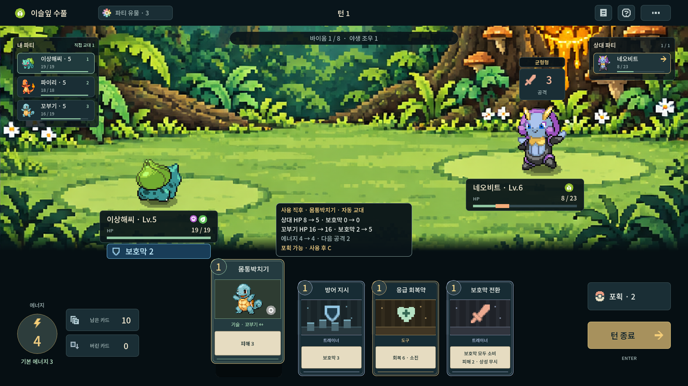

# 카드 사용 결과 미리보기

손패 카드에 마우스를 올리면 전투 중앙 아래에 **사용 직후** 예측을 표시한다. 카드에서 벗어나거나 메뉴/카드 더미를 열거나 행동 연출이 시작되면 사라진다. 상시 패널을 추가하지 않고 기존 손패 확대·양옆 벌어짐·QWER 입력을 유지한다.

- 상대와 카드 사용자의 **HP·보호막 이전 → 이후**를 표시한다. 다른 동료의 기술은 자동 교대할 동료 이름과 그 동료의 상태를 보여준다.
- HP 바의 주황 구간은 잃을 체력, 연한 초록 구간은 회복할 체력이다. 교대할 동료의 HP를 현재 출전 포켓몬의 바에 겹쳐 그리지 않는다.
- **사용 후 에너지**에는 비용 할인과 유물의 에너지 회복도 반영한다. 다음 공격은 결과 상태의 출전 포켓몬을 기준으로 한 적의 예고 피해이며, 보호막을 차감하기 전 수치다. 상대를 쓰러뜨리면 다음 상대의 공격임을 구분하고 마지막 상대라면 전투 승리를 표시한다.
- 야생에서는 **사용 후 포획 가능 / 부족한 조건 / 쓰러뜨려 포획 불가**를 표시한다. 일반 25%, 준전설·환상 15%, 초전설 10%의 HP와 등급별 에너지·볼·도전 조건을 기존 포획 검사로 판정한다. ‘사용 후 C’는 카드를 사용한 뒤 포획할 수 있다는 뜻이다.
- 사용 불가능한 카드, 행동 연출 중, 결과/메뉴가 열린 상태에는 예측을 표시하지 않는다. 키보드로 카드를 바로 사용하는 동작은 그대로다.

예측은 **그 카드 하나를 사용한 직후**다. 턴 종료 시 상태 피해나 이후에 사용할 카드까지 예약 실행하는 기능은 아니다. 아직 뽑지 않은 카드 이름과 덱 순서를 공개하지 않는다.

## 구현과 검증

`BattleCardPreview`는 포켓몬·네 더미의 카드·전투 플래그·유물·통계·난수를 복제한 전투에서 실제 `play_card()`를 실행하고 표시용 결과만 반환한다. 다른 동료의 교대 리본·교대 배턴, 상태 회수, 보호막 전환, 회복 상한, 핵심 유물 비용/회복까지 실제 처리와 같은 결과를 사용한다. 원래 대상이 쓰러져 다음 적이 나오더라도 원래 대상의 HP 0을 유지한다.

`TacticalJourney.capture_reason()`은 읽기 전용 복제 전투를 선택적으로 받아 예측에 사용한다. 실제 포획 호출은 항상 진행 중 전투를 기본값으로 검사한다. 포획 조건·수치·카드 효과·저장 형식은 바꾸지 않는다. 사용자가 지정한 배경 좌표도 유지한다.

`BattleActionPreview`는 기존 HUD와 손패 사이에 잠깐 나타나고 입력을 받지 않는다. 48개 배경에서 이동하는 HP·보호막·상태 영역을 모두 피하는지 검사한다. 새 HP 예측 구간은 기존 바의 자식이므로 배경별 위치 변경도 함께 따른다.

```bash
godot --headless --path . --script res://tests/test_battle_card_preview.gd
godot --headless --path . --script res://tests/test_action_preview_ui.gd
python3 tools/test_native_pointer.py --probe native_action_preview_probe
```

아래는 실제 Godot 렌더러로 촬영한 1920×1080 검사용 고정 장면이다. 파티·손패·유물을 지정하고 HP를 포획 경계 근처로 맞췄으며 사용자 저장이나 원정 플레이 기록이 아니다.


