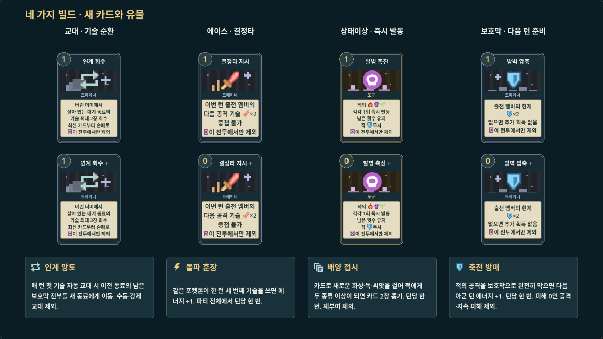

# 네 가지 빌드의 추가 카드와 유물

공용 카드 4종·일반 유물 4종을 추가했다. 이 첫 확장 당시 풀은 **공용 카드 27종과 부상·일반 유물 14종·핵심 유물 5종·지닌 물건 6종**이었다. 이후 [여섯 콘셉트 확장](build-concepts.md)으로 공용 55종·일반 26유물까지 늘렸다. 카드 사용 순서와 준비한 자원을 보상으로 전환하는 콘텐츠다. 아래 수치는 신규 콘텐츠의 초기값이며 밸런스 조정·추가 난도 측정은 보류한다.



위쪽은 기본 카드, 아래쪽은 강화 카드다. 카드는 모두 사용 후 해당 전투에서 소진하며 다음 전투에서는 원정 덱으로 돌아온다. 아이콘이 대체하는 명칭을 반복하지 않고 대상·동작·조건·기간을 설명한다. 전체 한국어 툴팁도 유지한다.

## 카드

| 빌드 | 카드 | 비용 | 효과 | 강화 |
|---|---|---:|---|---|
| 교대 | 연계 회수 | 1 | 버린 더미에서 살아 있는 **대기 동료**의 기술을 최신순 최대 2장 회수 | 최대 3장 |
| 에이스 | 결정타 지시 | 1 | 이번 턴 **현재 출전 멤버**의 다음 공격 기술 피해 2배 | 비용 0 |
| 상태 | 발병 촉진 | 1 | 적의 화상·씨앗·독을 각각 1회 즉시 발동. 남은 횟수 유지 | 비용 0 |
| 보호막 | 방벽 압축 | 1 | 현재 출전 멤버의 남은 보호막 2배 | 비용 0 |

발병 촉진은 **도구**, 나머지는 **트레이너**다. 기술은 기존 포켓몬의 레벨별 기술 풀을 사용한다.

- **연계 회수:** 실제 사본과 강화를 보존한다. 현재 출전 멤버·기절/이탈한 소유자·공용 카드는 제외한다. 손패 10장 제한을 적용하며 들어가지 못한 카드는 버린 더미에 남는다. 회수하는 행위 자체가 교대는 아니며, 회수한 다른 동료의 기술을 쓰면 기존 규칙대로 자동 교대한다.
- **결정타 지시:** 사용 당시의 출전 UID에 귀속한다. 다른 동료의 공격·보호막 전환·상태 피해는 표식을 쓰지 않는다. 같은 턴에 돌아오면 사용할 수 있고 사용하지 않으면 다음 아군 턴에 해제한다. 공격 외 기술은 유지하며, 상성 무효인 공격은 피해 0을 유지하고 표식을 소비한다. 같은 표식의 재부여는 중첩하지 않는다. 자속·상성·추가 피해·침식 촉매 계산 후 2배를 적용하고 적 보호막은 정상 적용한다. HP 아래에 ×2 아이콘과 상세 설명을 표시한다.
- **발병 촉진:** 정규 지속 피해와 같은 함수로 소모전 작전·침식 촉매·씨앗 흡수를 계산한다. 적 보호막을 무시하고 수면·마비·혼란은 발동하지 않는다. 상태 재부여가 아니어서 잔류 시약·상태 관측경·배양 접시를 발동하지 않는다. 원래 상대가 기절하면 중단하고 다음 적을 추가 타격하지 않는다. 씨앗 흡수는 살아 있는 실제 시전자만 받는다.
- **방벽 압축:** 현재 남은 보호막만큼 추가한다. 0이면 0이며 수호 부적의 고정 가산을 다시 받지 않는다. 보호막의 기존 v3 저장 상한 100,000을 전투 중에도 적용하고 실제 획득량만 표시·기록한다. 카드 면에 실제 추가량을 표시한다. 적의 예고에 대비해 남기거나 보호막 전환으로 공격할 수 있다.

## 일반 유물

| 유물 | 발동과 효과 |
|---|---|
| 인계 망토 | 매 턴 첫 기술 자동 교대 시, 이전 동료의 남은 보호막 전부를 새 동료에게 **이동** |
| 돌파 훈장 | 같은 포켓몬의 한 턴 세 번째 기술 사용 시 에너지 +1. 파티 전체에서 턴당 한 번 |
| 배양 접시 | 카드로 새로운 화상·독·씨앗을 걸어 적에게 두 종류 이상이 되면 2장 뽑기. 턴당 한 번 |
| 축전 방패 | 적의 공격을 보호막으로 완전히 막으면 다음 아군 턴 에너지 +1. 턴당 한 번 |

인계 망토는 수동·강제 교대를 제외한다. 첫 기술 자동 교대 때 보호막이 0이어도 해당 턴 기회를 사용한다. 출전 멤버의 기존 보호막·릴레이 작전·교대 리본과 합산하고 이전 멤버에게는 남지 않는다. 보호막 이동을 소비 → 교대 → 새 멤버 획득 단계로 보여준다.

돌파 훈장은 공격 외 기술도 세지만 서로 다른 세 멤버의 기술 한 번씩으로는 발동하지 않는다. 기술의 에너지를 먼저 지불할 수 있어야 한다. 집중 문장·릴레이 발전기·순환 엔진 등과 함께 사용한다.

배양 접시는 같은 상태를 다시 걸기만 하면 발동하지 않는다. 카드로 새 지속 피해 종류를 추가해 둘 이상이 되는 순간에 발동하며 손패 제한을 유지한다. 수면 등은 종류 수에서 제외한다.

축전 방패는 양수 공격 피해를 전부 보호막으로 흡수해야 한다. 부분 방어·원래 피해 0인 공격·보호막을 무시하는 지속 피해는 제외한다. 연타를 여러 번 막아도 한 번만 충전하고, 실제 다음 아군 턴에 스피드 에너지와 별도로 지급한다. 전투 종료 시 남은 충전은 다음 전투로 가져가지 않는다.

## 획득과 저장

기존 일반 전투 보상과 상점 카드 풀에 추가했고 조합 관련 후보에도 반영했다. 인계 망토는 교대/보호막, 나머지는 각 빌드의 관련 카드를 찾는다. 관장 전용 핵심 유물 5종과 일반 유물은 기존 분류를 따른다. 이미 제시된 보상·가격·매진·덱은 유지하고 새로 생성하는 후보부터 확장 풀을 사용한다.

v3 저장 형식과 콘텐츠 지문을 유지한다. 신규 카드/유물 ID·일회 표식·충전·턴당 발동 제한은 기존 카드/유물 목록과 `turn_flags`로 저장한다. 이어하기 후 표식이나 발동 기회가 다시 생기지 않는다. 연출 프레임에도 플래그 사본을 넣어 결과 계산이 먼저 끝나도 화면에서는 해당 단계에 아이콘이 변한다. 미리보기는 복제한 전투로 계산하며 원정 상태와 게임 난수를 변경하지 않는다.

## 검증과 다음 범위

```bash
godot --headless --path . --script res://tests/test_build_payoffs.gd
godot --headless --path . --script res://tests/test_build_payoffs_ui.gd
python3 tools/test_native_pointer.py --probe native_build_payoffs_probe
```

Linux/Godot 4.7.2 기준으로 신규 규칙·v3 실제 디스크 저장/복원·보상/상점 접근성 120개, UI 헤드리스 12개·실제 X11 13개(10클릭), 792개 카드 얼굴의 아이콘/잘림 2,797개와 미리보기 5,241개 검사를 통과했다. 기존 조합·핵심 유물·상점·공유 덱·원정/저장도 회귀 검사한다. 카드 갤러리는 검토용 렌더링이며 실제 1920×1080 전투에서도 효과를 실행했다.

일반 유물의 후반 수렴과 카드/유물 풀의 폭, 개별 조합의 재미·난도는 여전히 후속 과제다. 자동 원정 완주는 사람의 승률이나 균형을 입증하지 않는다. Windows 실행과 수동 플레이 검증도 남아 있다.
