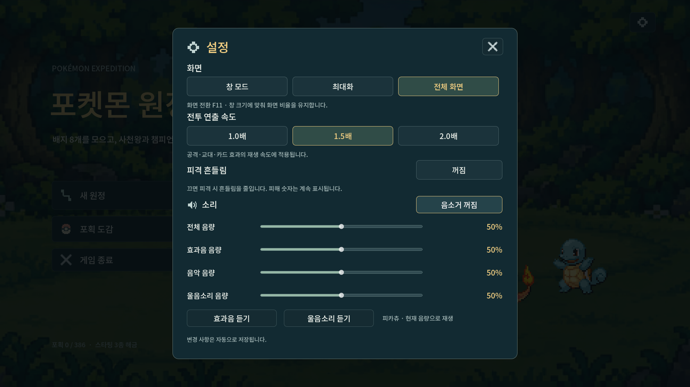

# 포켓몬별 울음소리

1~3세대 #001–386의 울음소리를 게임 파일에 포함했다. 실행 중 다운로드하지 않는다. [모바일용 울음소리 모음](audio/cries-preview.mp3)에서 아래 순서로 확인할 수 있다. 각 소리는 자르지 않고 사이에 0.5초를 두었다.

이상해씨 → 파이리 → 꼬부기 → 피카츄 → 이브이 → 치코리타 → 브케인 → 리아코 → 나무지기 → 아차모 → 물짱이 → 뮤츠 → 루기아 → 레쿠쟈.

- 전투 화면에 처음 나타나는 아군이 울고, 야생 상대는 1초 뒤에 운다. 그 전에 행동을 시작하면 대기 중인 야생 울음소리를 취소한다. 기절한 아군과 종료된 전투의 등장 소리는 생략한다.
- 트레이너의 첫 상대는 트레이너가 공을 던져 포켓몬이 나타나는 순간에 운다. 수동 교대·기술의 자동 교대·상대의 다음 포켓몬도 회수 후 **새로 표시된 종**의 울음소리를 낸다.
- 카드 사용 확정이나 HUD 갱신에는 재생하지 않는다. 회수하면 그쪽의 남은 소리를 끄며 전투를 떠나거나 장면을 바꾸면 모두 끈다.
- 설정에 **울음소리 음량**과 피카츄 미리 듣기를 추가했다. 기본 75%이며 전체·효과음·음악과 독립적으로 저장한다. 0%·음소거에서는 진행 중인 소리와 새 요청을 끄고, 나중에 몰아서 재생하지 않는다. 전투 연출 속도는 울음소리의 음높이를 바꾸지 않는다.



## 출처와 구현

원본은 [PokéAPI/cries](https://github.com/PokeAPI/cries)의 `latest`이며 커밋 `b3a9044bb839b5e3152aaa536c7b463a0fcf0140`에 고정했다. 프로젝트에서 직접 합성한 음악·효과음과 구분한다. 원본 저장소는 Showdown·Veekun·The Sounds Resource를 출처로 명시하며, 원본 LICENSE는 오디오의 저작권자를 The Pokémon Company로 명시한다. 원본 [README](../assets/audio/cries/UPSTREAM_README.md)와 [LICENSE](../assets/audio/cries/UPSTREAM_LICENSE)를 보존했다.

원본 #025는 `.ogg` 이름과 달리 MP3 비트스트림이어서 Godot에 맞게 Ogg Vorbis로 변환했다. 나머지는 원본 그대로다. [manifest](../assets/audio/cries/manifest.json)에 원본/포함 파일 지문·전체 디코딩한 PCM 지문·길이·검토 모음 지문을 기록했다. 원작 3세대 음원만 모은 세트가 아니라 현재 `latest` 울음소리 세트다.

`GameCries`는 `Cries → Game → Master` 버스와 아군/적 두 플레이어를 쓴다. 실제 사용할 때 로드하고 최근 12종만 캐시한다. 음악·효과음과 함께 재생할 여유를 위해 플레이어에 고정 0.35배 게인을 둔다. 게임 난수·전투 계산·카드·성장·경제·원정 저장을 참조하거나 변경하지 않는다.

```bash
python3 tools/fetch_pokemon_cries.py --check     # 오프라인: 386개 전체 디코딩·지문 검사
python3 tools/fetch_pokemon_cries.py --download  # 고정한 원본 재다운로드·모음 생성 (FFmpeg 필요)
godot --headless --audio-driver Dummy --path . --script res://tests/test_cries.gd
```

클라우드 검증은 Linux/Godot 4.7.2의 Dummy 오디오 드라이버에서 실제 믹서 PCM을 캡처한다. 실제 스피커 청음과 Windows 오디오 장치 검사는 별도 미완료다.
