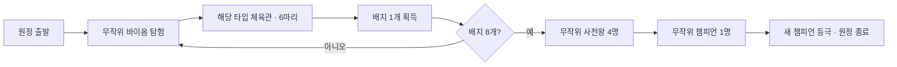

# 정식 원정: 배지 8개와 챔피언 도전

이 문서는 정식 게임의 진행 목표다. 현재 플레이 가능한 [햇살숲 짧은 원정](short-expedition.md)은 한 지역의 검증용 프로토타입이며, 아래의 8개 바이옴·체육관 6마리·리그 진행은 아직 게임 코드에 연결하지 않았다.

## 확정된 진행

1. 무작위로 정해진 바이옴 8곳을 순서대로 통과한다.
2. 각 바이옴의 마지막 스테이지에서는 해당 타입의 체육관 관장과 싸운다. 관장은 **포켓몬 6마리 파티**를 사용한다.
3. 체육관 관장을 이길 때마다 배지 1개를 받는다. 배지 8개를 모두 얻어야 리그에 도전한다.
4. 전 지방의 사천왕 중 무작위로 정해진 **4명**과 싸운다.
5. 이어서 전 지방의 챔피언 중 무작위로 정해진 **1명**과 싸운다.
6. 마지막 챔피언을 이기면 플레이어가 새로운 챔피언이 되고 원정을 마친다. 체육관 8승이나 사천왕 4승만으로는 최종 승리가 아니다.

정식 원정의 필수 보스전은 **체육관 8회 + 사천왕 4회 + 챔피언 1회 = 13회**다. 바이옴 내부의 야생·일반 트레이너 전투는 여기에 별도로 포함된다.

## 인물과 포켓몬 범위

- 체육관 관장·사천왕·챔피언의 **출신 지방은 제한하지 않는다**. 타입별 체육관 후보에는 그 타입을 전문으로 하는 전 지방의 관장이 들어갈 수 있다.
- 인물 범위 확장은 포켓몬 범위 확장과 별개다. 포켓몬은 기존 방침대로 전체 시스템 개발 동안 **관동 원종 #001~151**만 사용한다. 다른 지방·지역폼·메가진화는 이후에 추가한다.
- 따라서 다른 지방 인물의 원작 파티와 에이스를 그대로 넣는다고 가정하지 않는다. 현재 범위에서는 관동 포켓몬으로 그 인물의 타입·전술을 표현하는 게임용 파티를 작성한다.
- 플레이어 파티는 기존 최대 3마리 규칙을 유지한다. 관장의 6마리와 비대칭이므로 적 체력·기술·교체·보상 수치는 별도로 조정한다.
- **6마리 확정 조건은 체육관 관장에게 적용한다.** 사천왕·챔피언의 개별 파티 인원수, 등장 인물 전체 명단과 각 파티 편성은 후속 콘텐츠 설계에서 정한다.

### 관동 제한에 따른 타입 구성 초안

관동에는 악타입 원종이 없고, 강철은 코일·레어코일 2종, 고스트는 고오스·고우스트·팬텀 3종, 드래곤은 미뇽·신뇽·망나뇽 3종뿐이다. 모든 관장을 ‘같은 타입의 서로 다른 종 6마리’로 만들 수는 없다.

현재 초안은 **해당 타입의 핵심 포켓몬 + 테마와 약점을 보완하는 관동 포켓몬**으로 6마리를 편성하는 방식이다. 악타입 체육관은 기존 그믐밤 숲과 같이 야행성·교란 전술의 테마 예외로 표시한다. 등장 포켓몬의 실제 타입을 바꾸거나 다른 지방 포켓몬을 몰래 추가하지 않는다. 세부 파티는 콘텐츠 제작 단계에서 확정한다.

## 추첨 세부 규칙 초안

사용자가 정한 인원수·배지·승리 조건과 구분되는 구현 기본안이다.

- 준비된 18개 타입 바이옴 중 **서로 다른 8개**를 뽑아 방문 순서를 정한다. 같은 타입을 다시 방문해 배지를 반복 획득하지 않는다.
- 각 바이옴에는 그 타입의 관장 후보 중 한 명을 배정한다. 여러 지방의 후보를 함께 사용할 수 있다.
- 사천왕은 전 지방 후보를 합친 풀에서 **서로 다른 인물 4명**을 뽑고 전투 순서를 정한다. 같은 타입 전문가가 여러 명 뽑히는 것은 허용한다.
- 챔피언은 전 지방 후보 풀에서 한 명을 뽑는다. 사천왕과 챔피언을 겸했던 인물은 같은 원정에 두 역할로 중복 등장하지 않도록 공통 인물 ID로 구분한다.
- 바이옴·관장·사천왕·챔피언 추첨은 원정 시드로 고정한다. 화면 재진입이나 이어하기로 다시 뽑지 않는다. 전투 드로우·카드 보상의 난수와 분리한다.
- 후보가 부족하면 인물을 중복해서 채우지 않고 콘텐츠 검증에서 문제를 표시한다. 지역별 추첨 가중치는 아직 정하지 않았다.

## 체육관전과 원정 상태

- 체육관의 6마리는 **하나의 트레이너 파티와 한 번의 전투**다. 여섯 개의 독립 전투나 여섯 개의 배지로 나누지 않는다.
- 적도 한 마리씩 출전하며, 출전 적이 기절하면 남은 멤버로 교체한다. 여섯 마리가 모두 기절해야 관장에게 승리한다.
- 적 한 마리를 쓰러뜨릴 때마다 손패·에너지·HP를 초기화하거나 일반 전투 보상을 지급하지 않는다. 배지와 전투 보상은 관장전 전체를 이겼을 때 한 번만 지급한다.
- 체육관·사천왕·챔피언의 포켓몬은 포획할 수 없다. 플레이어 전멸은 원정 실패다.
- 파티·덱·체력·경험치는 바이옴과 리그 사이에도 원정 상태로 유지한다. 자동 회복이나 리그 사이의 휴식은 아직 확정하지 않았다.
- 적 교체 직후의 행동 순서, 보호막·상태의 이월, 사천왕·챔피언 파티 인원수와 중간 회복 규칙은 다수 적 전투 구현 전에 세부 규칙을 정한다.

배지는 인물 이름에만 연결하지 않고 원정의 바이옴·타입·격파한 관장을 함께 기록한다. 동일 관장전의 중복 결과 처리는 배지를 늘리지 않는다. 리그는 배지 8개 확인 → 사천왕 진행도 0~4 → 챔피언전 → 등극 결과의 순서로 잠근다.

## 길이와 개발 순서

기존의 ‘세 지역 뒤 체육관 격파’ 승리 조건은 폐기한다. 기존 30~45분 목표와 지역당 약 10개 노드도 새 규모에 맞춰 다시 조정한다. 현재 9개 장소 프로토타입을 8번 그대로 반복하는 구성을 확정한 것은 아니다.

1. **적 파티 전투:** 적 6마리 인스턴스·교체·행동 예고·전체 승패, 관장전 정산 한 번, 적 파티 UI.
2. **바이옴·관장·배지:** 시드별 바이옴 8개와 관장 배정, 관장 6마리 편성 데이터, 배지 획득·중복 방지·다음 바이옴 이동.
3. **리그:** 전 지방 사천왕·챔피언 후보, 사천왕 4명과 챔피언 1명 추첨, 리그 해금·진행·챔피언 등극 화면.
4. **장기 원정 보완:** 진행 저장, 바이옴별 노드 수·회복·난이도 조정, 체육관/리그 전체를 끝까지 플레이하는 검사.

현재의 짧은 원정 완주 검사와 새 정식 원정의 배지·리그 검사는 따로 유지한다. 문서 반영을 정식 원정 플레이 기능의 완료로 표시하지 않는다.
