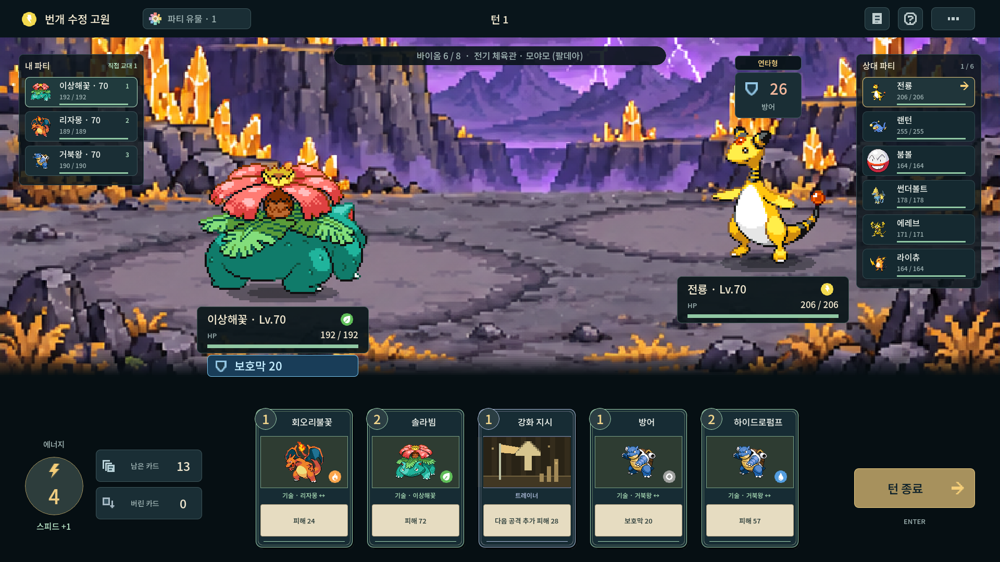

# 전 지방 관장 후보

본가 8개 체육관 지방의 **82팀·83명**을 등록했다. 풍·란은 공동 관장 한 팀이다. 버전 차이·전임·후임, 가라르 마이너리그의 도정/세이버리와 전임 관장 마스터드/피오니를 포함한다. 알로라는 체육관 제도가 없어 시련의 캡틴·섬의 왕을 이 후보에 넣지 않는다. 애니메이션 전용·비공인 도장 관장과 사천왕을 관장으로 추가하지 않는다.

모든 파티는 1~3세대 원종 중 전설·환상을 제외한 서로 다른 여섯 종이다. 다른 지방의 원작 에이스를 그대로 사용할 수 없어, 해당 범위의 타입과 기존 전술로 편성했다. 원작 버전의 파티를 재현한 목록이 아니다.

전문 관장은 자신의 타입 바이옴에서 등장한다. 전문 타입이 없는 **그린은 혼합 파티로 모든 바이옴 후보**에 들어간다. 여러 타입에 들어가 매 원정에 지나치게 자주 나오지 않도록 타입별 추첨 가중치를 다른 관장의 1/18로 둔다. 같은 타입 전문 관장끼리는 같은 가중치다.

챔피언을 먼저 정한 다음 별도 관장 난수로 각 바이옴의 후보를 뽑는다. 관장·사천왕·챔피언 역할에 같은 인물이 중복되지 않는다. 독수·윤진·아이리스·청목·그린도 동일 인물 ID로 제외한다. 시드로 고정하며 목록 조회/화면 재진입으로 대진을 바꾸지 않는다.

**기존 저장은 원래 대진을 유지한다.** 확장 후보는 새 원정부터 적용한다. [저장 호환](persistence.md#관장-후보-확장의-호환-처리)을 따른다. 개별 원작 초상·의상은 이번 범위가 아니며 기존 공용 트레이너 도입을 사용한다.

1920×1080 렌더링 예시. 시드로 선택된 실제 모야모 편성에 동레벨 비교 파티를 놓은 독립 검토 장면이며 이전 전투를 플레이한 기록은 아니다.

## 타입별 후보

| 타입 | 전문 후보 | 인물 |
|---|---:|---|
| 노말 | 5팀 | 꼭두(성도) · 종길(호연) · 알로에(하나) · 체렌(하나) · 청목(팔데아) |
| 격투 | 6팀 | 사도(성도) · 철구(호연) · 자두(신오) · 코르니(칼로스) · 채두(가라르) · 마스터드(가라르) |
| 비행 | 3팀 | 비상(성도) · 은송(호연) · 풍란(하나) |
| 독 | 4팀 | 독수(관동) · 도희(관동) · 보미(하나) · 도정(가라르) |
| 땅 | 2팀 | 비주기(관동) · 야콘(하나) |
| 바위 | 6팀 | 웅(관동) · 원규(호연) · 강석(신오) · 자크로(칼로스) · 마쿠와(가라르) · 타임(팔데아) |
| 벌레 | 4팀 | 호일(성도) · 아티(하나) · 비올라(칼로스) · 단풍(팔데아) |
| 고스트 | 4팀 | 유빈(성도) · 멜리사(신오) · 어니언(가라르) · 라임(팔데아) |
| 강철 | 3팀 | 규리(성도) · 동관(신오) · 피오니(가라르) |
| 불꽃 | 4팀 | 강연(관동) · 민지(호연) · 팟(하나) · 순무(가라르) |
| 물 | 8팀 | 이슬(관동) · 윤진(호연) · 아단(호연) · 맥실러(신오) · 콘(하나) · 시즈(하나) · 야청(가라르) · 곤포(팔데아) |
| 풀 | 6팀 | 민화(관동) · 유채(신오) · 덴트(하나) · 후쿠지(칼로스) · 아킬(가라르) · 콜사(팔데아) |
| 전기 | 6팀 | 마티스(관동) · 암페어(호연) · 전진(신오) · 카밀레(하나) · 시트론(칼로스) · 모야모(팔데아) |
| 에스퍼 | 5팀 | 초련(관동) · 풍·란(호연) · 고지카(칼로스) · 세이버리(가라르) · 리파(팔데아) |
| 얼음 | 6팀 | 류옹(성도) · 무청(신오) · 담죽(하나) · 우르프(칼로스) · 멜론(가라르) · 그루샤(팔데아) |
| 드래곤 | 4팀 | 이향(성도) · 사간(하나) · 아이리스(하나) · 금랑(가라르) |
| 악 | 2팀 | 두송(가라르) · 마리(가라르) |
| 페어리 | 3팀 | 마슈(칼로스) · 포플러(가라르) · 비트(가라르) |

그린(관동)은 위 전문 후보 수에 포함하지 않은 혼합 후보 한 팀이다. 전체 지방별 이름·편성은 [관장 전체 편성](gym-candidates.md), 실행 데이터는 [gym_leaders.json](../data/gym_leaders.json)을 따른다.

## 기존 18개 기준 편성

`data/gyms.json`과 `VisualCatalog.gym_for_type()`은 이전 원정의 경로 서명과 개발용 아트 랩을 유지하는 기준 편성이다. 현재 새 원정의 전체 후보는 `GymLeaders`/`gym_leaders.json`이며 `gym_candidates_for_type()`으로 조회한다. 기존 기준 파일에 후보를 덧붙여 과거 저장의 대진을 바꾸지 않는다.

관장전은 여전히 바이옴당 여덟 번째 전투이고 파티는 6마리다. 레벨·배지·보상·전투/야영지 횟수는 [정식 원정](full-campaign.md)을 유지한다.
