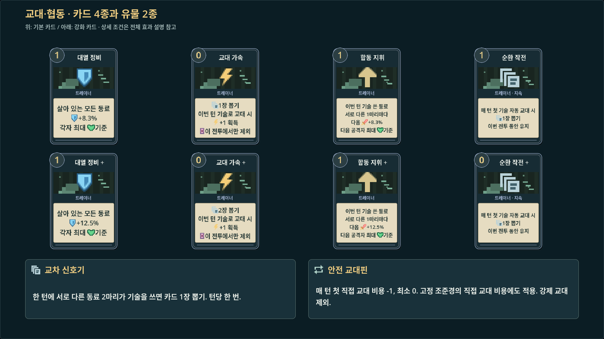
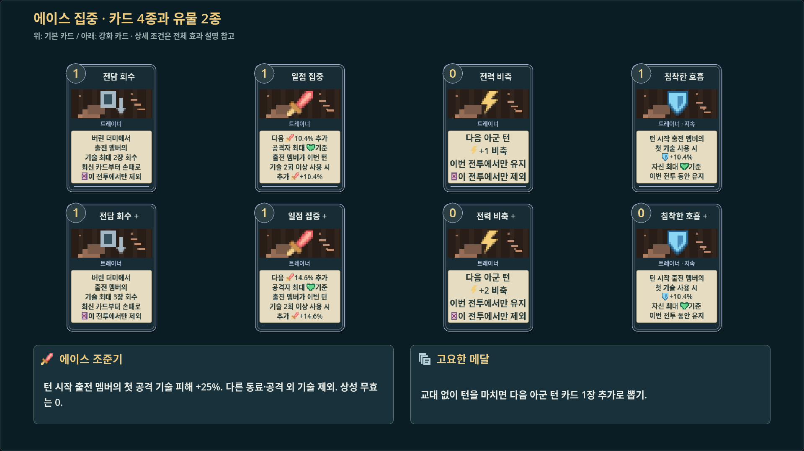
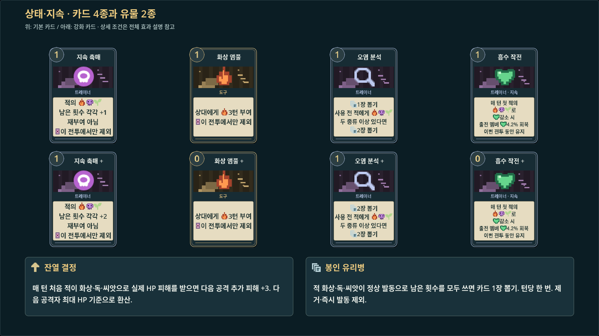
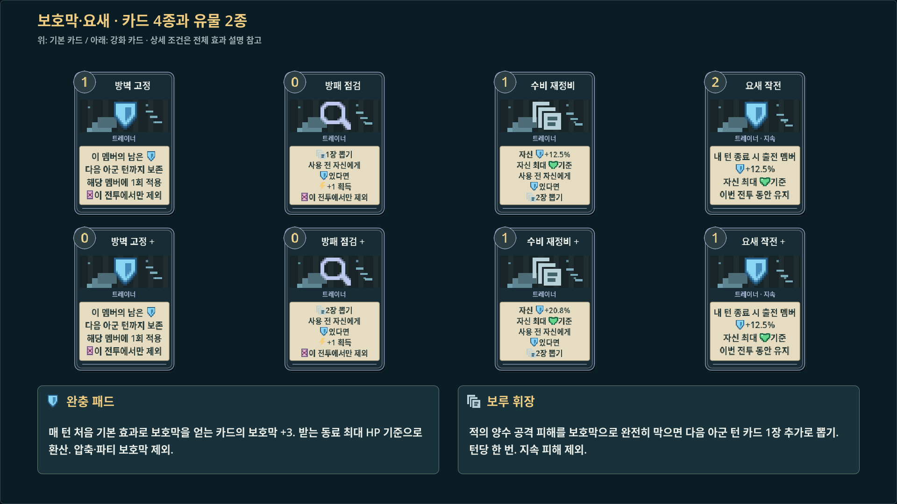
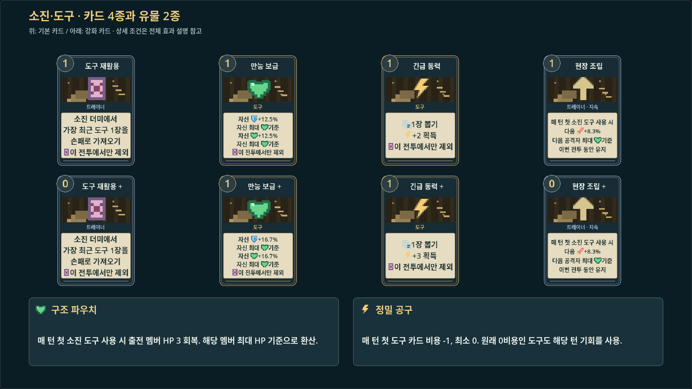
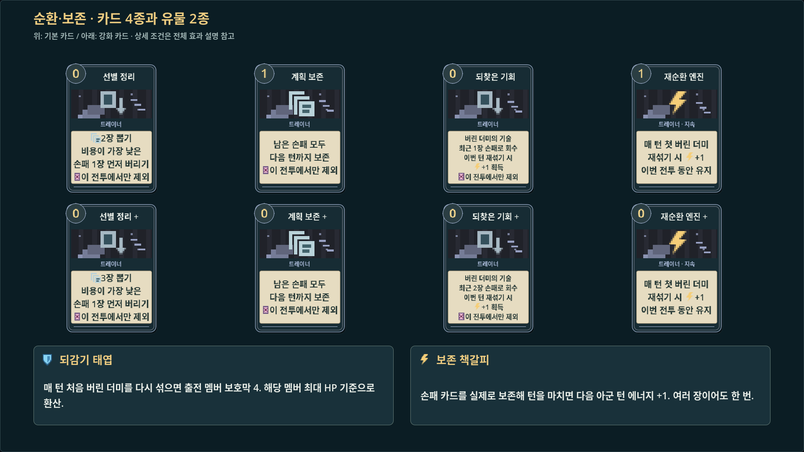
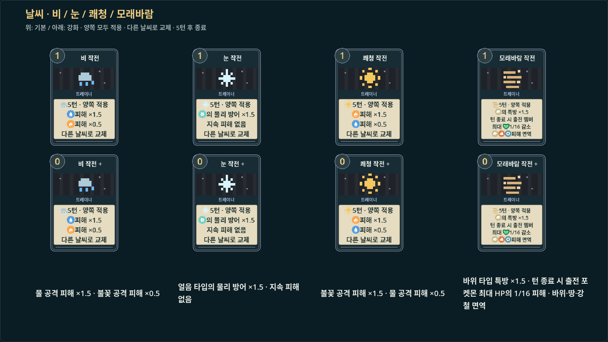
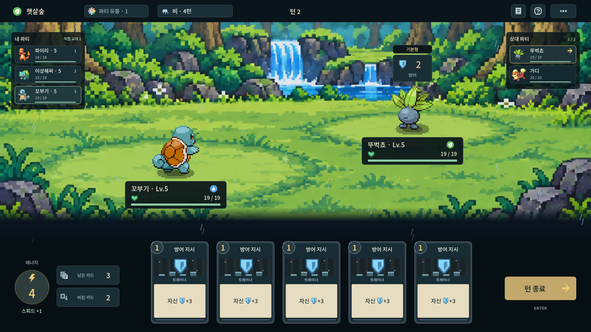
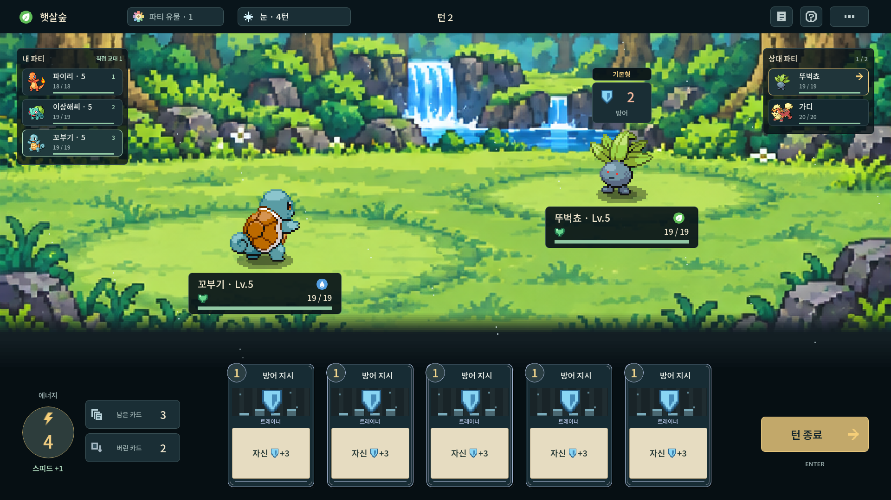
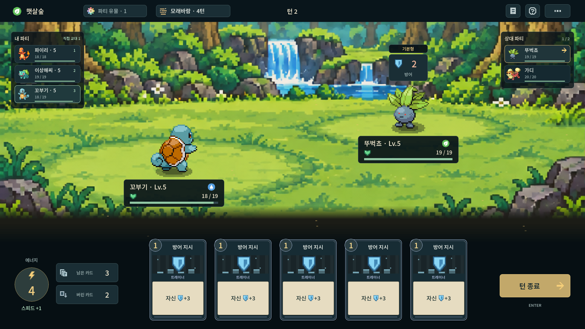

# 카드·유물 콘셉트 확장과 날씨

2026-10-17 · 구현 기준 [`874c625`](https://github.com/agree-git/pokemon-deckbuilder/commit/874c625) · 실제 Godot 4.7.2/Linux 1920×1080 렌더링.

6개 콘셉트의 **신규 카드 24종·일반 유물 12종**과 **날씨 카드 4종**이다. 현재 공용 카드 55종과 부상·일반 유물 26종·핵심 유물 5종·지닌 물건 6종. 카드 모음 위는 기본, 아래는 강화 카드다. 신규 효과 수치는 초기값이며 밸런스 조정은 보류한다.

[전체 이미지 ZIP 다운로드](build-concepts.zip) · [카드별 효과·강화·유물 규칙](https://github.com/agree-git/pokemon-deckbuilder/blob/main/docs/build-concepts.md) · [날씨 규칙](https://github.com/agree-git/pokemon-deckbuilder/blob/main/docs/weather.md)

모바일에서는 각 이미지를 누르면 크게 볼 수 있다. 코드와 문서는 `main`, 검토용 이미지는 이 브랜치에 보관한다.

## 교대·협동

## 에이스 집중

## 상태·지속

## 보호막·요새

## 소진·도구

## 순환·보존

## 날씨

양쪽에 공통 적용하며 한 번에 한 종류, **5턴**이다. 다른 날씨로 교체하고 재사용 시 5턴으로 갱신한다. 교대해도 유지하며 전투 종료 시 해제한다. 아래 전투 화면은 같은 기본 편성으로 날씨의 HUD와 연출을 비교하는 개발 검토 장면이다. 적 난도·승률을 비교한 자료가 아니다.

| 날씨 | 효과 |
|---|---|
| 비 | 물 피해 ×1.5 · 불꽃 피해 ×0.5 |
| 눈 | 얼음 타입 물리 방어 ×1.5 · 지속 피해 없음 |
| 쾌청 | 불꽃 피해 ×1.5 · 물 피해 ×0.5 |
| 모래바람 | 바위 특방 ×1.5 · 출전 멤버 최대 HP의 1/16 피해 · 바위/땅/강철 면역 |

### 비 전투 예시

### 눈 전투 예시

### 쾌청 전투 예시

### 모래바람 전투 예시

규칙·획득·실제 디스크 저장/복원, 카드 설명 876얼굴, 적 공격 예고와 실제 피해, X11 포인터 입력을 검사했다. 원정 회귀 검사에서도 세 시드가 각각 69전을 완료했다. 자동 완주가 사람의 재미·승률을 보장하지 않으며 Windows 실행 검증은 별도다.
