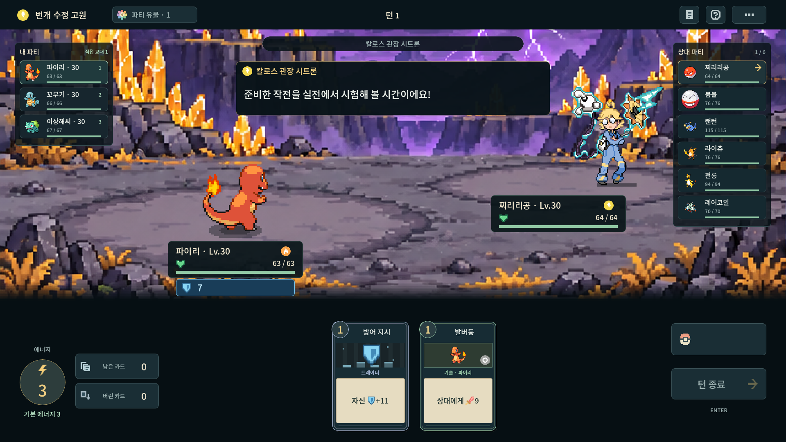
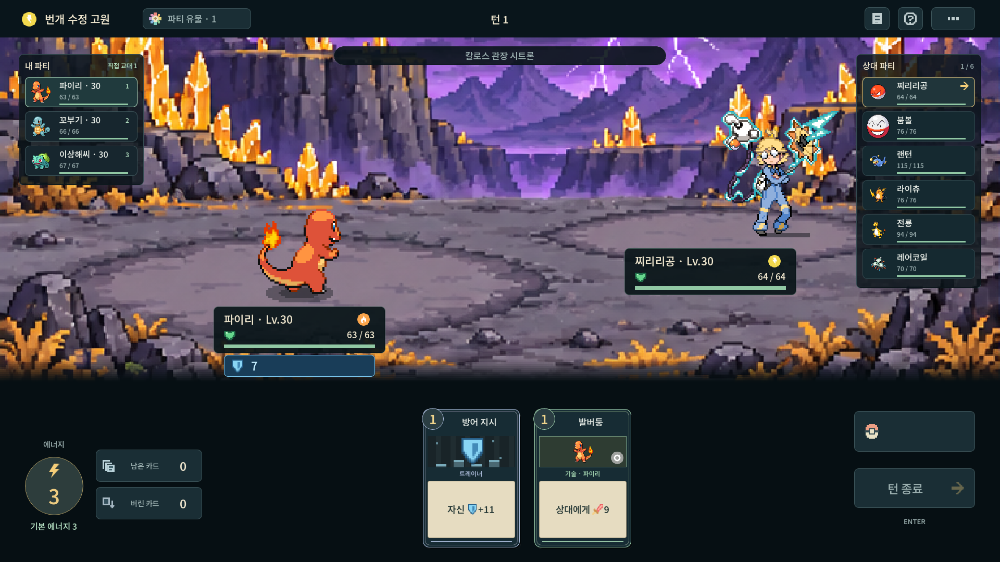
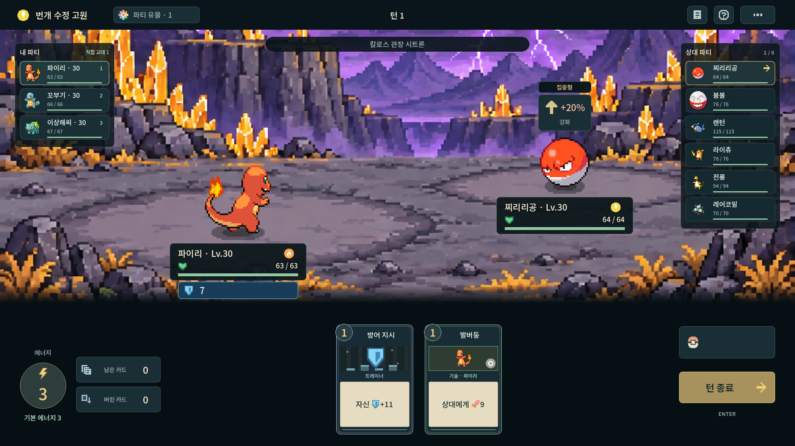

# 시트론 도트 적용 — 모든 보스 대진 개별 외형 완료

게임 commit: [`f4b53a5`](https://github.com/agree-git/pokemon-deckbuilder/tree/f4b53a573d94c7ef37a6937bec304853c7808446). **124대진 / PNG 121장 / 공용 외형 대진 0개**. 원작 75대진/73 PNG와 팬 제작 49대진/48 PNG다.

[화면·원본·크레딧 ZIP](clemont-review.zip) · [전체 대진 CSV](trainer_sprites.csv) · [80×80 PNG](clemont.png) · [상세 적용 문서](../../docs/clemont-sprite.md)

제작자는 **Gnomowladny**. 사용자가 [원작 링크](https://www.deviantart.com/gnomowladny/art/Clemont-Sprite-430844892)와 참조 그림을 제공했다. 원작 페이지는 이 환경에서 접속하지 못했으며, 사용자가 제공한 작가 근거로 기록한다. 적용 파일은 기존 Smogon 고정 보관본으로 같은 포즈에 푸른 전기 효과가 포함된 버전이다. 제공 이미지/DeviantArt 다운로드와 바이트가 같다고 주장하지 않는다. PNG는 수정하지 않았다.

Godot 4.7.2/Linux import, 콘텐츠 **3,855개**, 실제 렌더링 **41개/세 속도**, 전체 **121 PNG** SHA/제작자 근거 검증을 통과했다. [콘텐츠 로그](content.log) · [렌더링 로그](native.log) · [전체 PNG 검사](sprites.log). 기존 120 PNG/대진·게임 코드·데이터·사용자 전장 좌표를 보존했다.

아래 9장은 실제 1920×1080 전투 창이다. Lv.30은 외형 비교용 테스트 데이터이며 실제 진행 난도/성장 변경이 아니다. 전투 입력 잠금, 실제 시트론 도트/대사, 투명 발끝·정수 최근접 배율·UI 안전 영역, 공 비행, 자연스러운 연출 완료와 상태/난수 불변을 검사했다. OS 클릭 검사는 아니다.

## 1배

## 1.5배

## 2배

