# 희귀 포켓몬 종별 단서와 첫 조우

게임 commit: [`07b0c41`](https://github.com/agree-git/pokemon-deckbuilder/tree/07b0c41cda136e3cf0694be792e4ad169c0254e1). **21종 · 고유 단서 95개 · 종별 장소/이동 배경/첫 등장 문장**을 연결했다. 새로 그린 유적 배경이 아니라 장소 분위기에 맞는 기존 바이옴 도트를 사용한다.

[화면·데이터 ZIP](rare-stories-review.zip) · [21종 장소 CSV](rare_sites.csv) · [95개 단서 CSV](rare_clues.csv) · [구현/재현](../../docs/rare-stories.md)

야영지에서 조사하면 이미 획득한 마지막 단서가 표시되고, 해당 장소로 이동한 뒤 짧은 조우 문장을 보여준다. 연출 동안 전투 행동은 잠기며 같은 전투 화면을 새로 고치거나 이미 행동한 전투 저장을 복원할 때는 반복하지 않는다.

Godot **4.7.2/Linux**: [콘텐츠/UI 741개](stories.log), [기존 희귀 규칙 1,329개](rules.log), [저장 1,759개](save.log), [실제 X11 78개/마우스 18클릭](native.log) 통과. [import](import.log). 단서 조사 비용·포획·레벨/보상·경로/난수·기존 배경 좌표는 유지했다.

아래는 실제 1920×1080 창의 12장이다. 프리져(시드24)·뮤(16)·뮤츠(14)의 마지막 단서 직전 상태를 구성한 UI 검사이며 앞선 전투를 모두 실제로 플레이한 자료나 밸런스 측정이 아니다. 조사는 실제 마우스로 수행했고 새 단서가 저장/복원되는지 확인했다.

## 프리져 · 준전설 · 고요한 빙벽

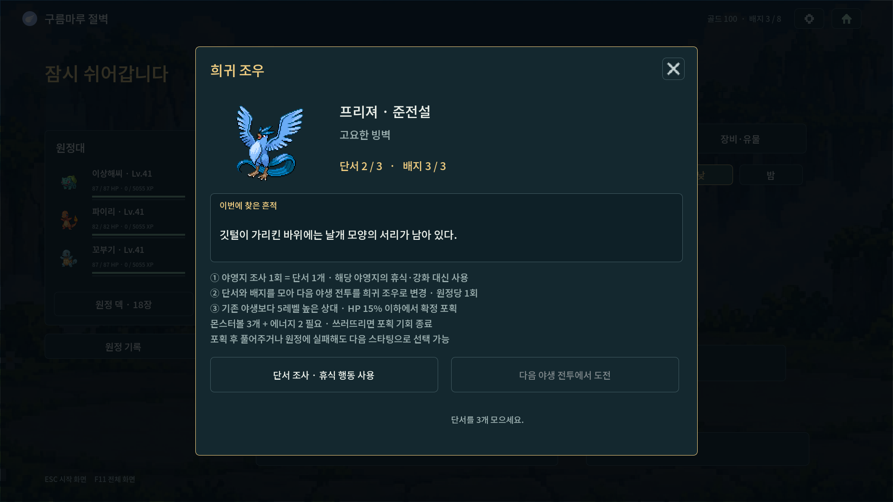

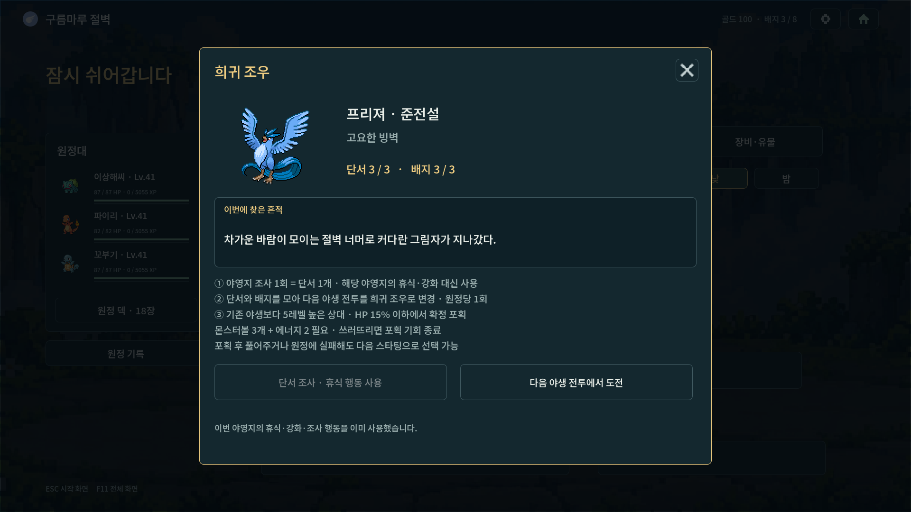

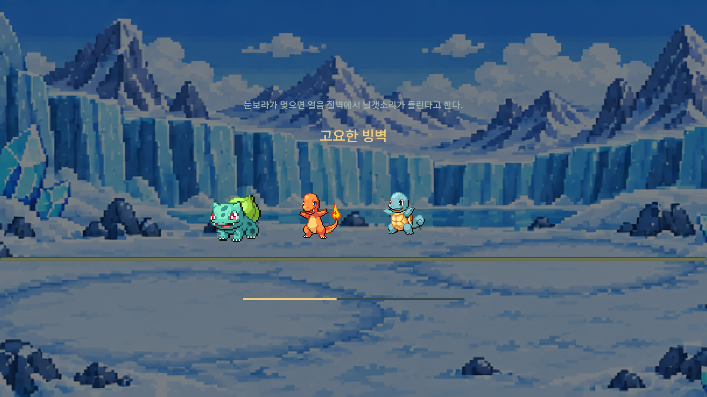

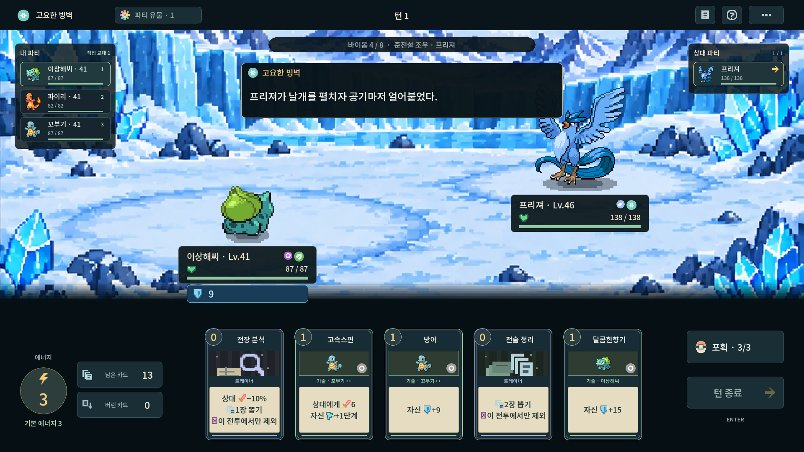

## 뮤 · 환상 · 장난꾸러기의 숲길

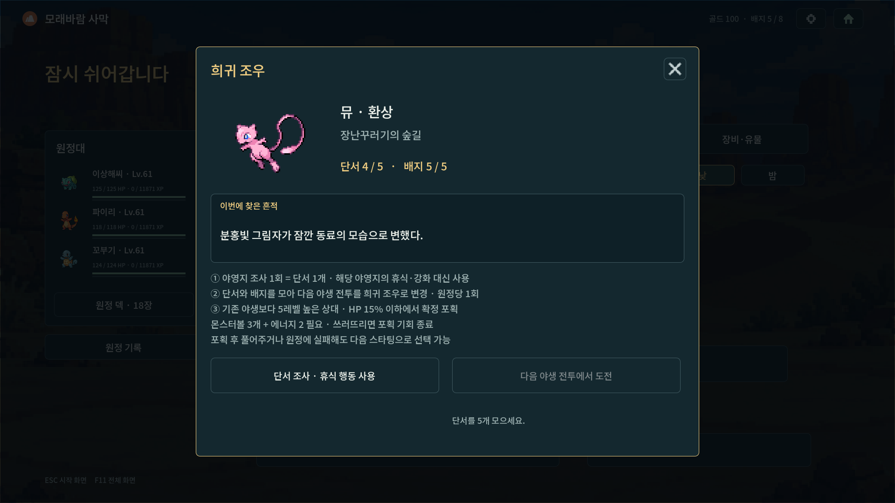

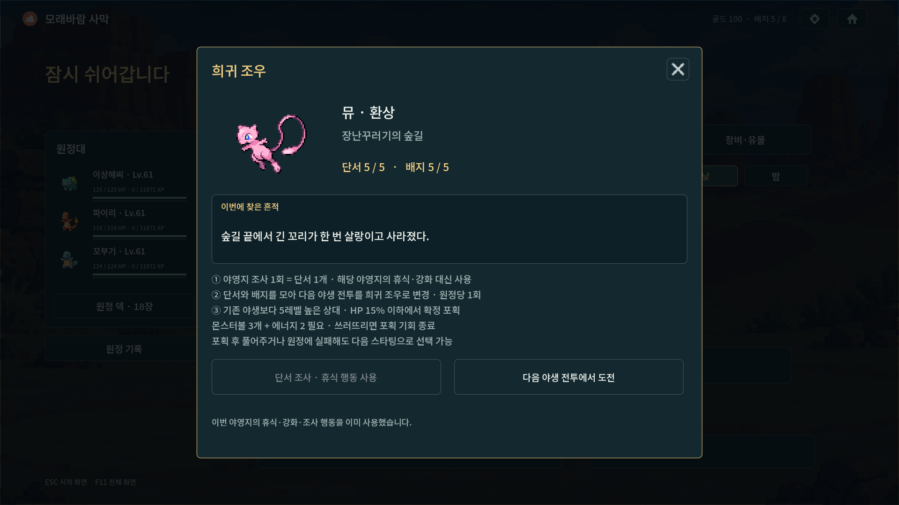

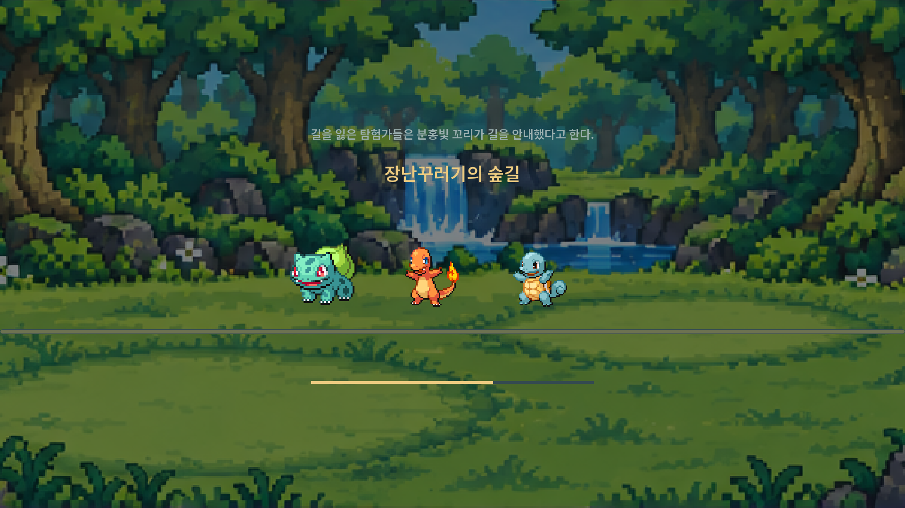

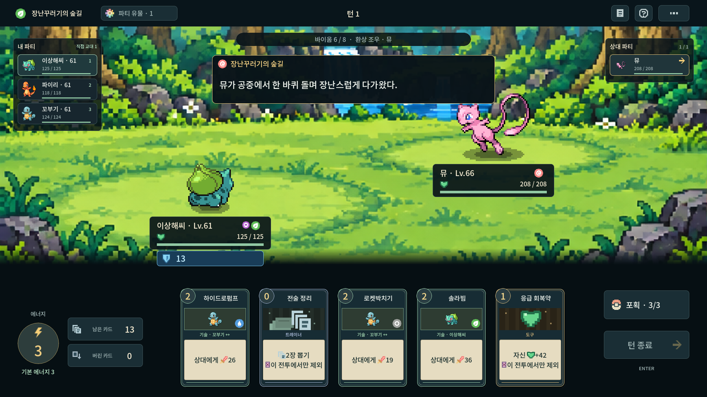

## 뮤츠 · 초전설 · 닫힌 실험실

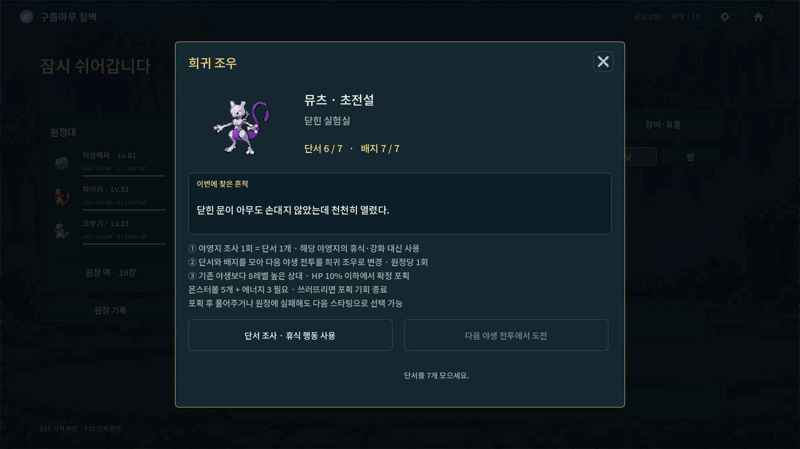

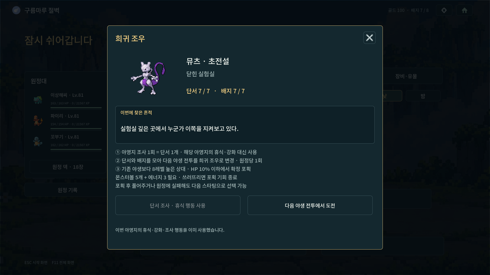

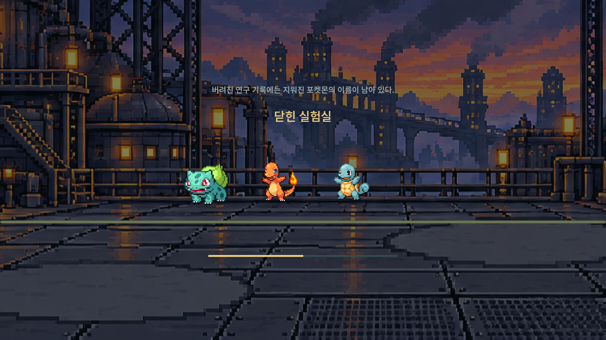

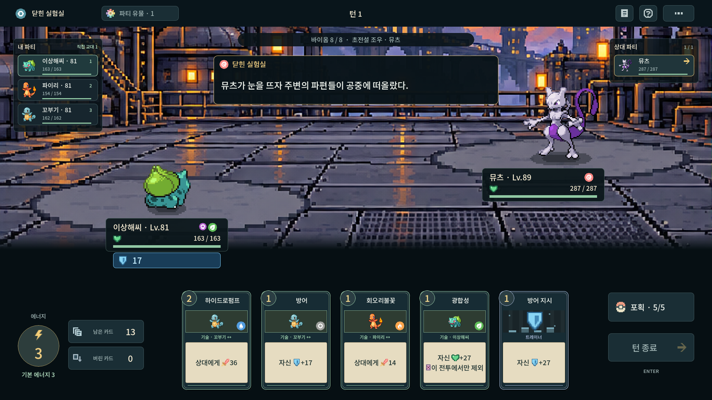

## 전체 장소

| 포켓몬 | 장소 | 단서 수 | 배경 |
|---|---|---|---|
| 프리져 | 고요한 빙벽 | 3 | ice |
| 썬더 | 벼락 맞은 철탑 | 3 | electric |
| 파이어 | 꺼지지 않는 화구 | 3 | fire |
| 뮤츠 | 닫힌 실험실 | 7 | steel |
| 뮤 | 장난꾸러기의 숲길 | 5 | grass |
| 라이코 | 천둥이 머문 들판 | 3 | electric |
| 앤테이 | 재 속의 발자국 | 3 | fire |
| 스이쿤 | 맑아진 물가 | 3 | water |
| 루기아 | 깊은 바다의 메아리 | 7 | water |
| 칠색조 | 무지개가 닿는 자리 | 7 | psychic |
| 세레비 | 시간이 멈춘 사당 | 5 | grass |
| 레지락 | 울림이 다른 바위문 | 3 | rock |
| 레지아이스 | 서리가 새는 봉인 | 3 | ice |
| 레지스틸 | 울리는 강철문 | 3 | steel |
| 라티아스 | 붉은 빛의 산책로 | 3 | grass |
| 라티오스 | 푸른 궤적의 능선 | 3 | flying |
| 가이오가 | 깊은 물결의 흔적 | 7 | water |
| 그란돈 | 깊은 땅의 흔적 | 7 | ground |
| 레쿠쟈 | 구름 위의 궤적 | 7 | flying |
| 지라치 | 별빛이 남은 바위 | 5 | psychic |
| 테오키스 | 별똥별의 낙하지 | 5 | rock |
