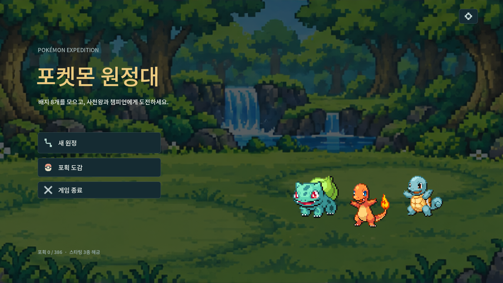
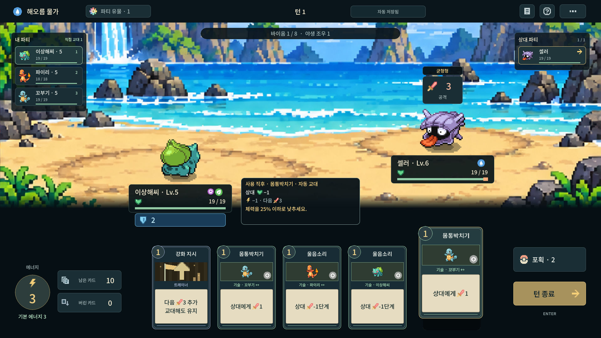
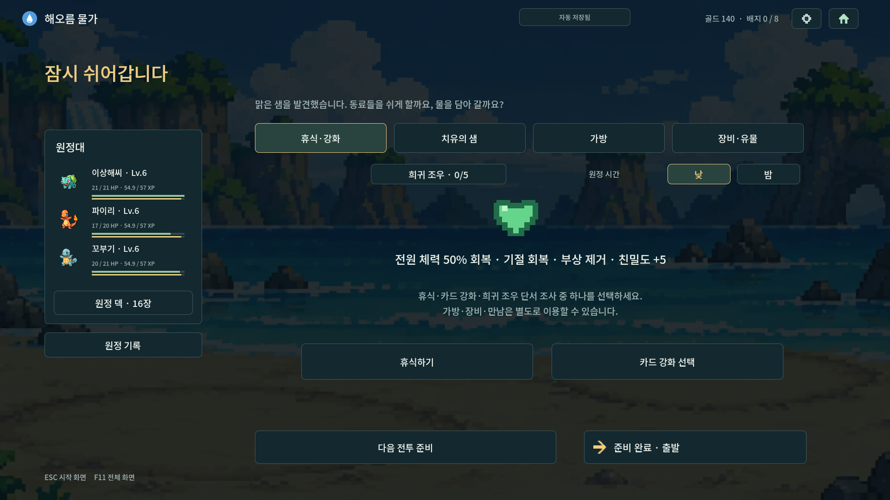

# 저장소 정리 검증 · 2026-10-17

정리한 게임 commit: [`8d0d219`](https://github.com/agree-git/pokemon-deckbuilder/tree/8d0d2196f4ad1d6ae31b207ed1a455ece36dd2c2). main은 게임 파일·필수 출처·짧은 실행 안내를 유지하고 개발 자료는 development-materials에 모은다. Godot 4.7.2/Linux에서 확인했다.

- 생성 캐시를 비운 새 import 완료: [로그](logs/main-fresh-import.log).
- 실제 X11 창: 시작 → 스타팅 세 마리 → 출발 로딩 → 실제 첫 야생 전투 → 보상 → 야영지 → 디스크 저장 → 시작 화면 → 이어하기. **16개 검사/실제 마우스 31회** 통과. [로그](logs/main-native.log).
- 기존 저장/복원 회귀 **1,759개**: [로그](logs/main-save-test.log).
- 기존 트레이너 콘텐츠/알파 경계/글꼴/대사/상태 불변 **3,561개**: [로그](logs/main-trainer-test.log).
- 유지한 이미지·음원·글꼴 1,338개와 게임 데이터 12개가 정리 전과 일치한다. 사용자 전장 JSON SHA도 유지한다. 참조 경로 891개와 자료 파일 177개의 원본/이동 후 SHA, 옛 브랜치 tip의 이력 보존을 확인했다. [대조 결과](layout-audit.json).
- 최종 로그에서 스크립트 오류·잔여 리소스 경고를 찾지 못했다. Xorg 드라이버의 V-Sync 미지원 경고는 별개다. Windows 실행/배포·밸런스 검증은 이번 범위가 아니다.

검사는 정리한 main을 경로로 지정하고 검사 스크립트를 체크아웃 외부에서 실행했다. `probe/`는 당시 클라우드 경로를 포함한 실행 기록이다. 직접 재사용하려면 경로/정책 helper/검사 대상 commit을 먼저 조정해야 하며 main에 테스트를 복원할 필요는 없다. 로그의 저장은 검사 전용 임시 사용자 디렉터리를 사용한다.

## 실제 실행 화면

## 최종 브랜치 상태

원격은 **main / development-materials 두 개**다. 기존 background-review·concept-review·trainer-dialogue-review·weather-field-review 브랜치는 삭제했다. 삭제 전 네 tip 이력과 177개 자료 파일 지문을 검증했으며 자료와 원본 commit 링크는 [보존 목록](../../docs/branch-archive.json)에 남아 있다. 과거 commit에 남은 개발 파일은 이력 보존을 위한 것이며 main 최신 파일 목록에는 포함되지 않는다.
