# 칼로스·알로라 트레이너 팬 도트 적용

게임 commit: [`fbe4834`](https://github.com/agree-git/pokemon-deckbuilder/tree/fbe4834af190f7a7ce697572a8011bc0f268c6ff). **원작 도트 75대진 + 팬 도트 14대진 = 89대진 / PNG 87장**. 나머지 35대진은 공용 도트를 유지한다.

[전체 대진 CSV](trainer_sprites.csv) · [화면/원본/크레딧 ZIP](trainer-fan-sprites.zip) · [적용 출처/조건](../../docs/trainer-fan-sprites.md)

아래 17장은 실제 Godot 4.7.2/Linux 1920×1080 창의 등장/투척 장면이다. 파티/상대 Lv.30은 같은 크기로 외형을 비교하기 위한 검토 fixture이며 실제 진행 순서나 난도 자료가 아니다. 원본 PNG는 수정하지 않고 정수 배율로 표시한다.

콘텐츠·알파 경계/모든 자세·글꼴·상태 불변 3,645개, 실제 렌더링 158개/14인물을 통과했다. [콘텐츠 로그](content.log) · [실제 렌더링 로그](native-final.log) · [import 로그](import.log). 원래 73개 PNG 명세와 게임 데이터 12개, 사용자 바닥 좌표 SHA는 유지했다.

## 아세로라 · elite:acerola

작가: **Beliot419** · [원본 PNG](https://raw.githubusercontent.com/smogon/sprites/a9214714f00974a8c28586829e6315d9ca5a6348/src/_uncategorized/noncanonical/trainers/gen7/sun-moon/Acerola.png)

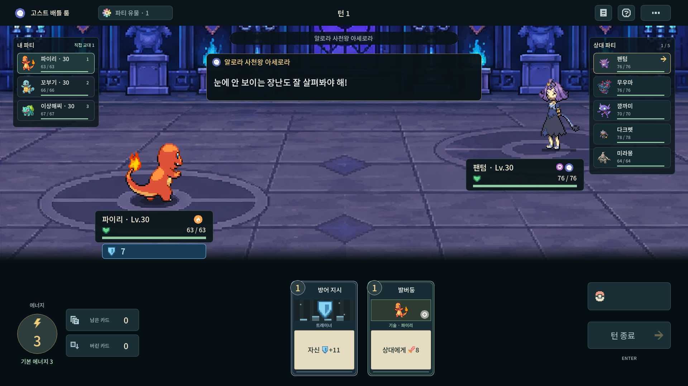

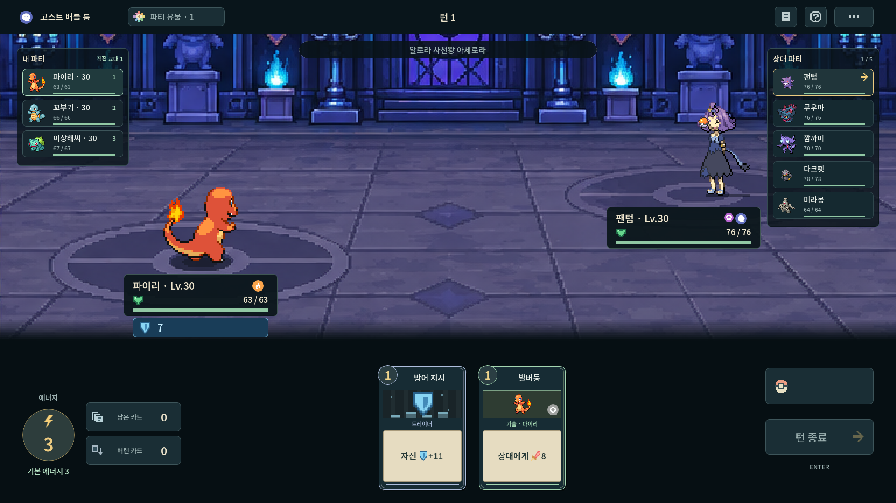

## 드라세나 · elite:drasna

작가: **Gnomowladny** · [원본 PNG](https://raw.githubusercontent.com/smogon/sprites/a9214714f00974a8c28586829e6315d9ca5a6348/src/_uncategorized/noncanonical/trainers/gen6/x-y/Drasna.png)

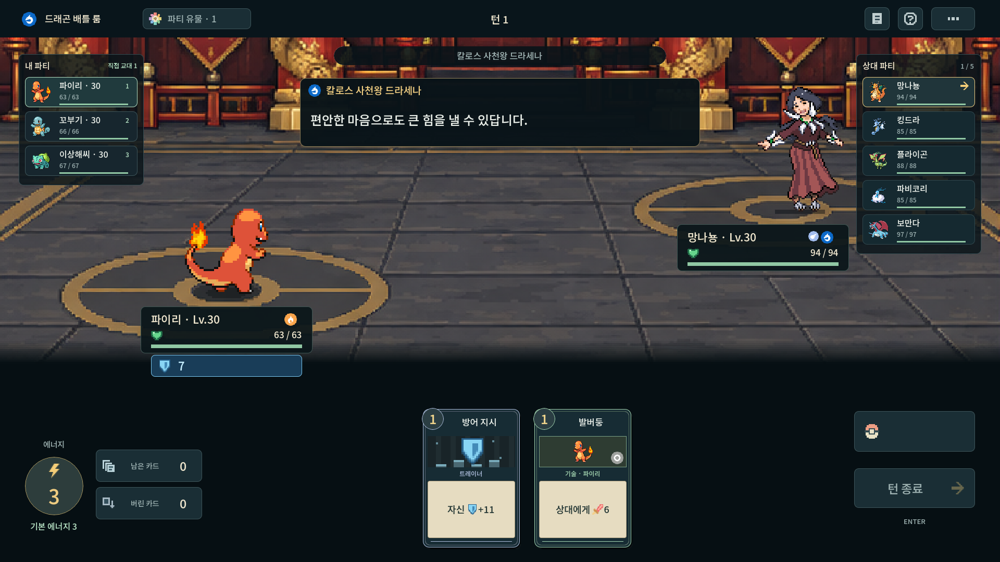

## 할라 · elite:hala

작가: **Gnomowladny** · [원본 PNG](https://raw.githubusercontent.com/smogon/sprites/a9214714f00974a8c28586829e6315d9ca5a6348/src/_uncategorized/noncanonical/trainers/gen7/sun-moon/Hala.png)

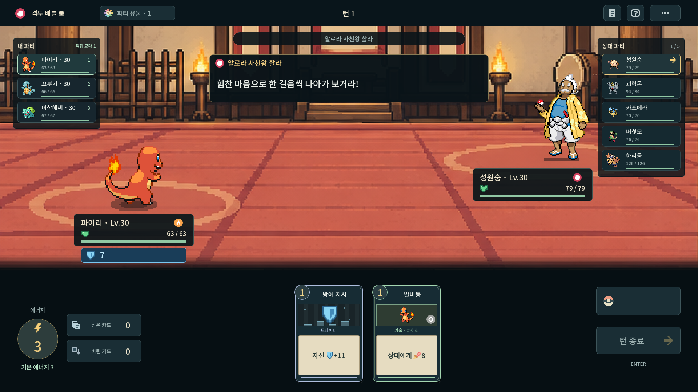

## 카일리 · elite:kahili

작가: **Beliot419** · [원본 PNG](https://raw.githubusercontent.com/smogon/sprites/a9214714f00974a8c28586829e6315d9ca5a6348/src/_uncategorized/noncanonical/trainers/gen7/sun-moon/Kahili.png)

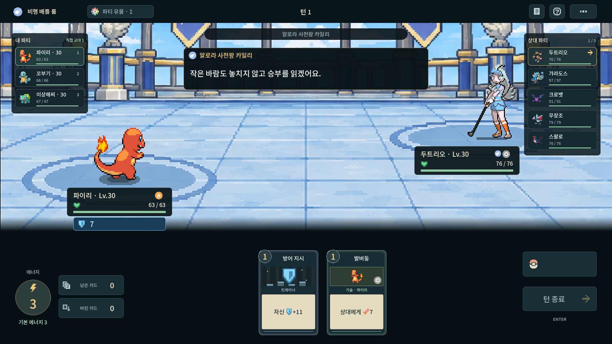

## 파키라 · elite:malva

작가: **Gnomowladny** · [원본 PNG](https://raw.githubusercontent.com/smogon/sprites/a9214714f00974a8c28586829e6315d9ca5a6348/src/_uncategorized/noncanonical/trainers/gen6/x-y/Malva.png)

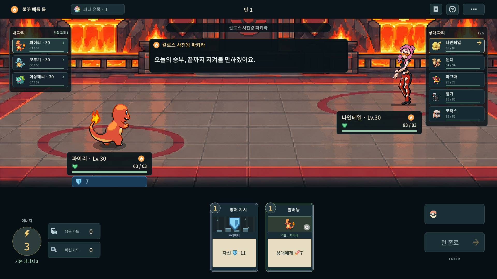

## 라이치 · elite:olivia

작가: **Beliot419** · [원본 PNG](https://raw.githubusercontent.com/smogon/sprites/a9214714f00974a8c28586829e6315d9ca5a6348/src/_uncategorized/noncanonical/trainers/gen7/sun-moon/Olivia.png)

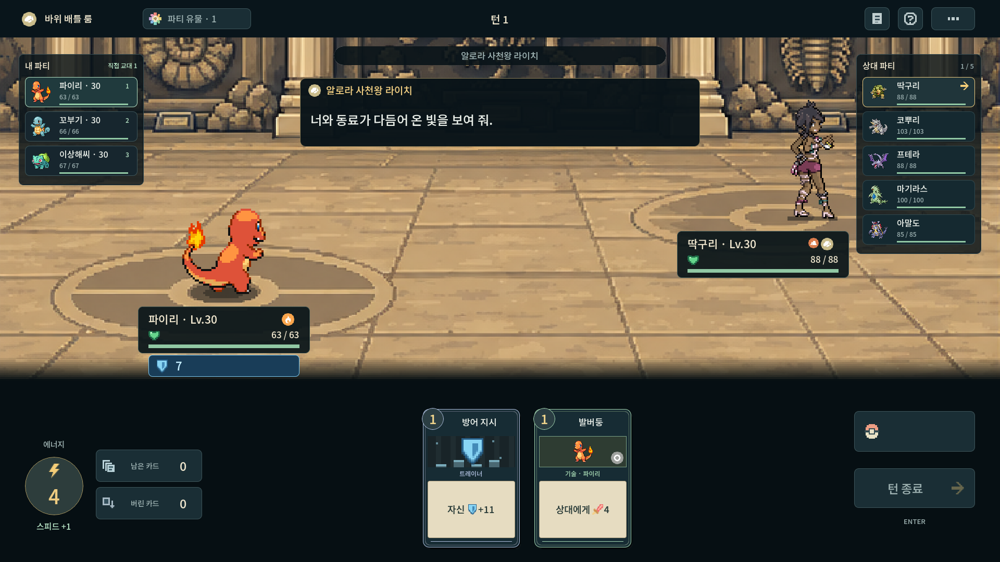

## 즈미 · elite:siebold

작가: **Gnomowladny** · [원본 PNG](https://raw.githubusercontent.com/smogon/sprites/a9214714f00974a8c28586829e6315d9ca5a6348/src/_uncategorized/noncanonical/trainers/gen6/x-y/Siebold.png)

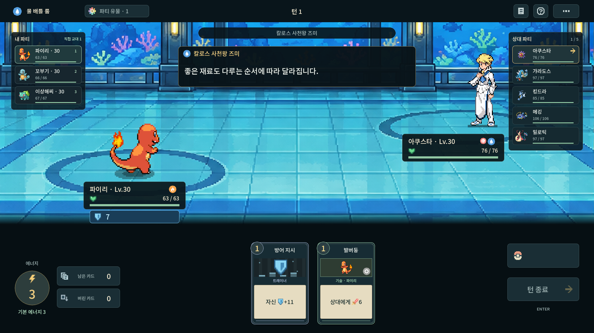

## 간피 · elite:wikstrom

작가: **Gnomowladny** · [원본 PNG](https://raw.githubusercontent.com/smogon/sprites/a9214714f00974a8c28586829e6315d9ca5a6348/src/_uncategorized/noncanonical/trainers/gen6/x-y/Wikstrom.png)

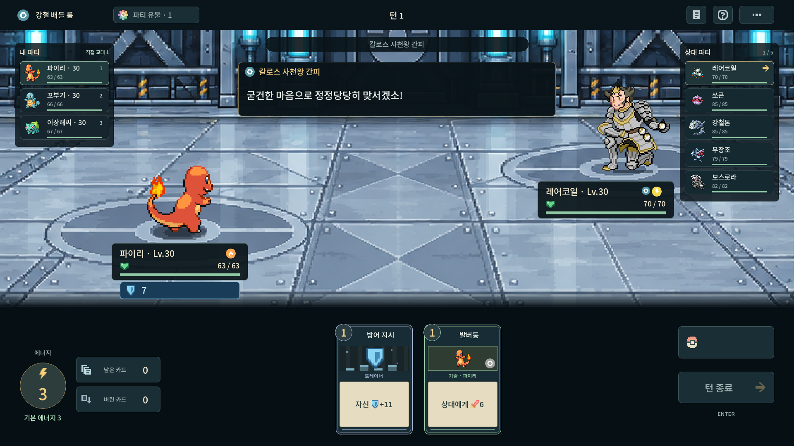

## 코르니 · gym:korrina

작가: **Gnomowladny** · [원본 PNG](https://raw.githubusercontent.com/smogon/sprites/a9214714f00974a8c28586829e6315d9ca5a6348/src/_uncategorized/noncanonical/trainers/gen6/x-y/Korrina.png)

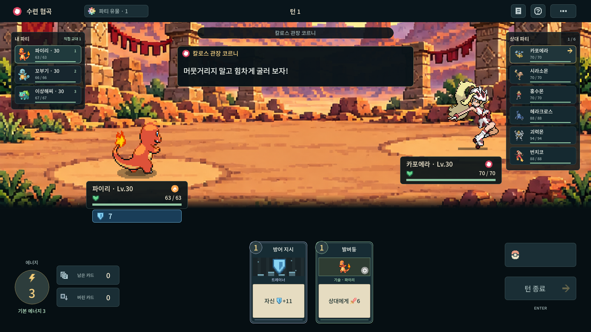

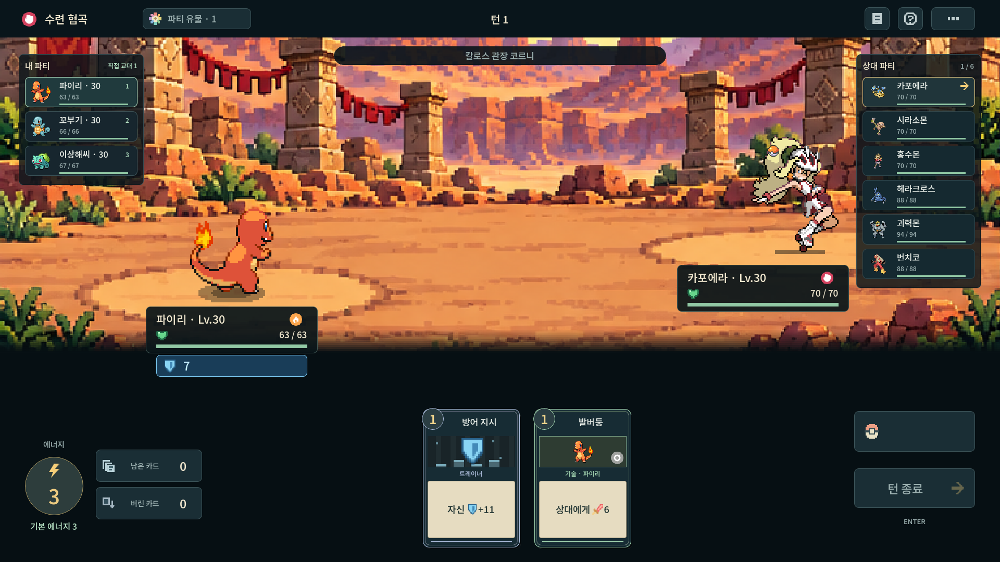

## 고지카 · gym:olympia

작가: **Gnomowladny** · [원본 PNG](https://raw.githubusercontent.com/smogon/sprites/a9214714f00974a8c28586829e6315d9ca5a6348/src/_uncategorized/noncanonical/trainers/gen6/x-y/Olympia.png)

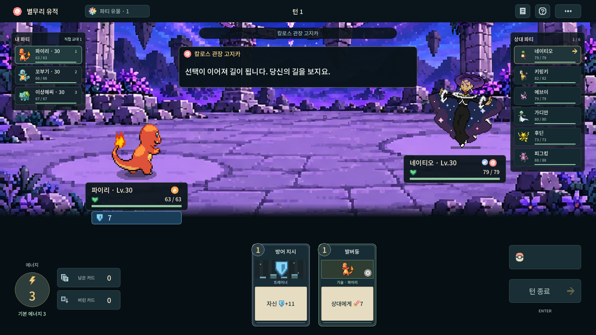

## 후쿠지 · gym:ramos

작가: **Gnomowladny** · [원본 PNG](https://raw.githubusercontent.com/smogon/sprites/a9214714f00974a8c28586829e6315d9ca5a6348/src/_uncategorized/noncanonical/trainers/gen6/x-y/Ramos.png)

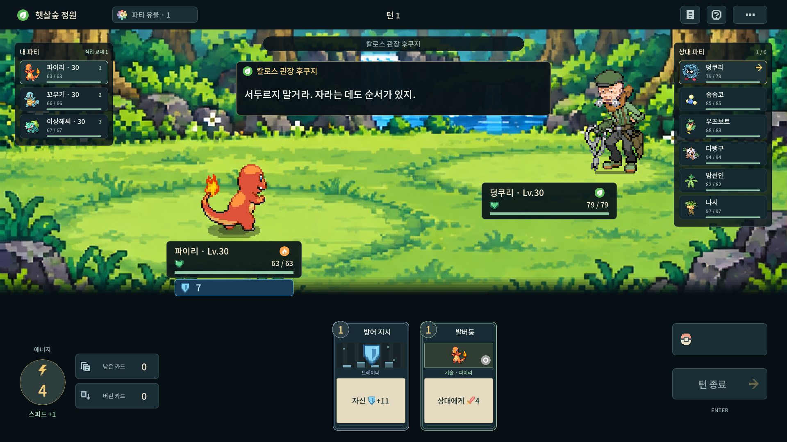

## 마슈 · gym:valerie

작가: **Gnomowladny** · [원본 PNG](https://raw.githubusercontent.com/smogon/sprites/a9214714f00974a8c28586829e6315d9ca5a6348/src/_uncategorized/noncanonical/trainers/gen6/x-y/Valerie.png)

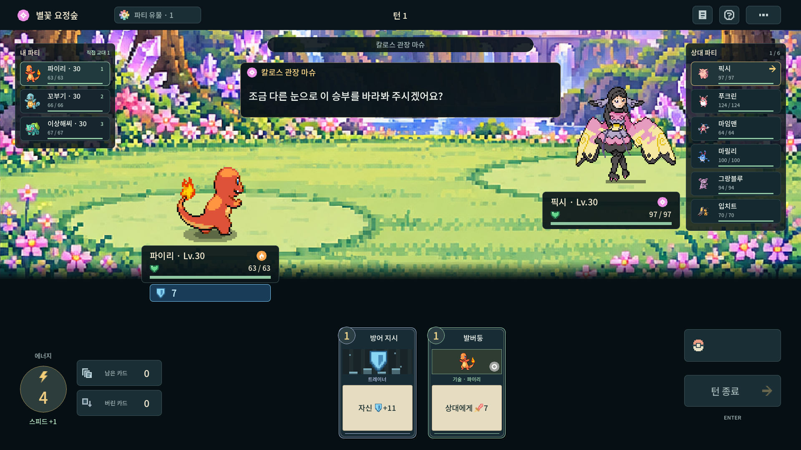

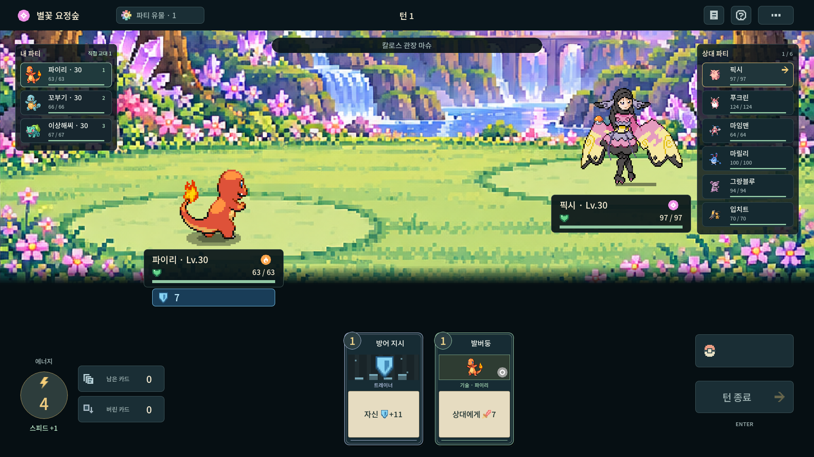

## 비올라 · gym:viola

작가: **Gnomowladny** · [원본 PNG](https://raw.githubusercontent.com/smogon/sprites/a9214714f00974a8c28586829e6315d9ca5a6348/src/_uncategorized/noncanonical/trainers/gen6/x-y/Viola.png)

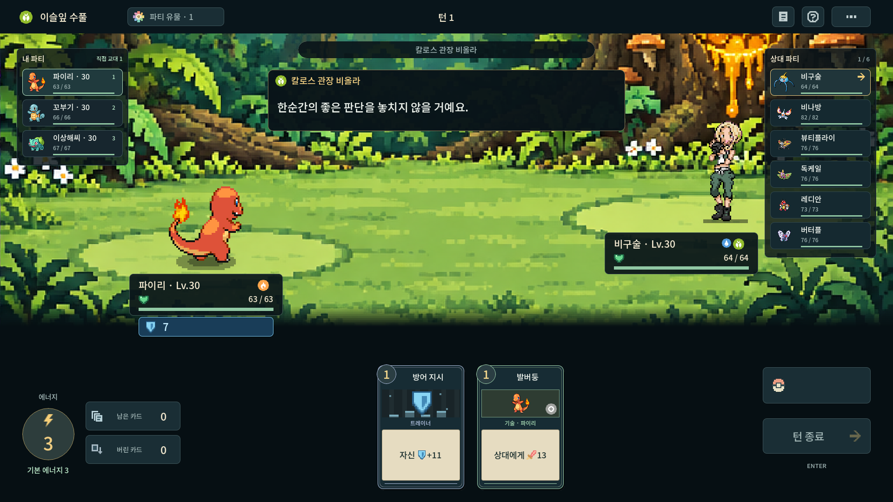

## 우르프 · gym:wulfric

작가: **Gnomowladny** · [원본 PNG](https://raw.githubusercontent.com/smogon/sprites/a9214714f00974a8c28586829e6315d9ca5a6348/src/_uncategorized/noncanonical/trainers/gen6/x-y/Wulfric.png)

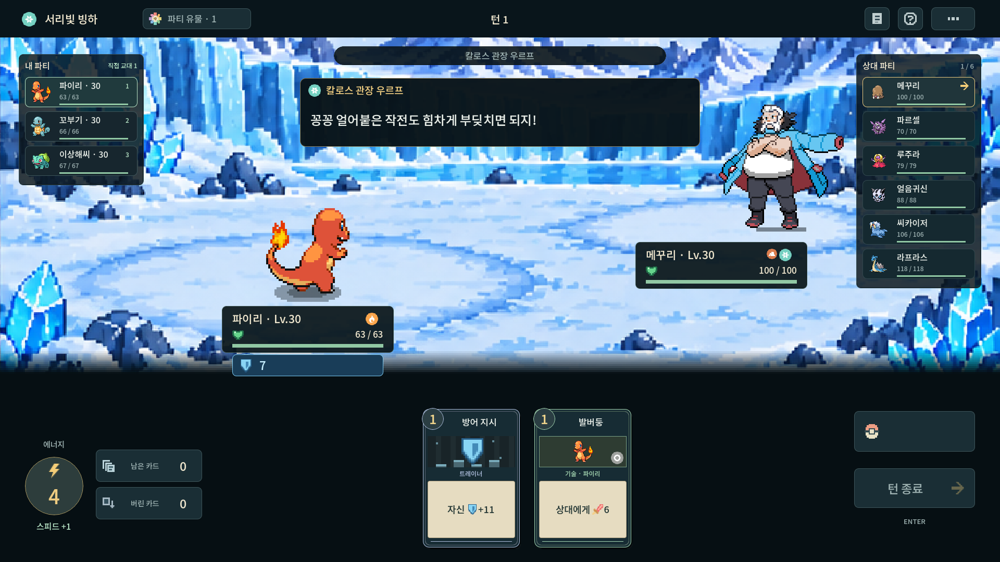

## 남은 대진

시트론·자크로·카르네와 가라르/팔데아의 32대진은 아직 공용 도트다. 시트론은 GitHub 파일 경로를 찾았지만 제작자 확인이 남았다. 특정 팬게임이 같은 그림을 썼다는 증거는 확인하지 않았다.
