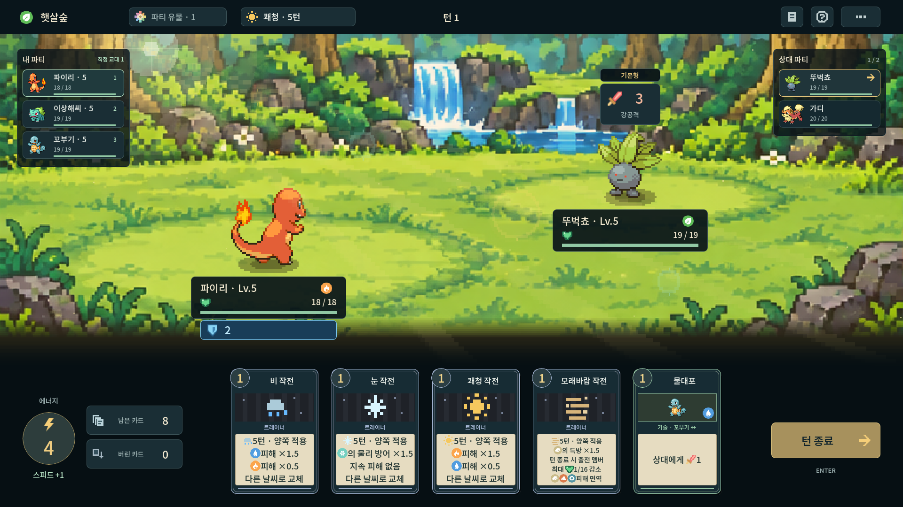
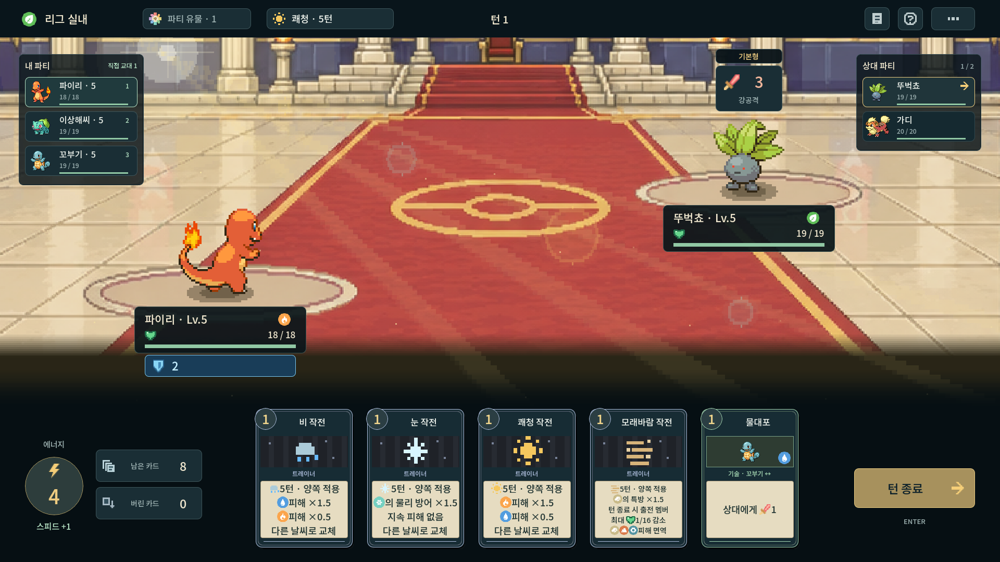
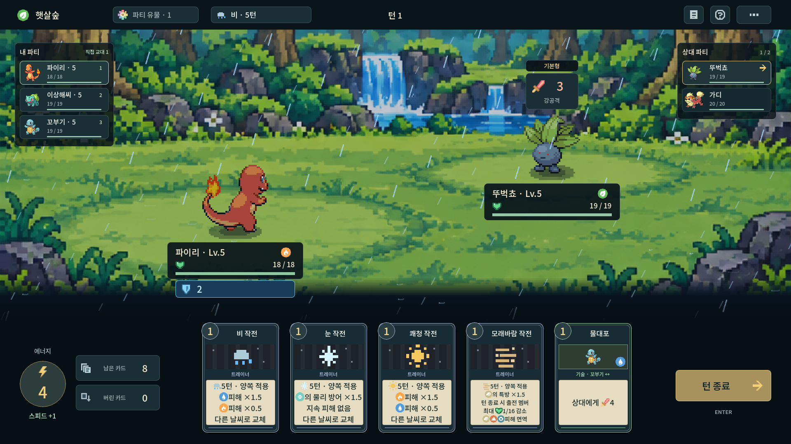
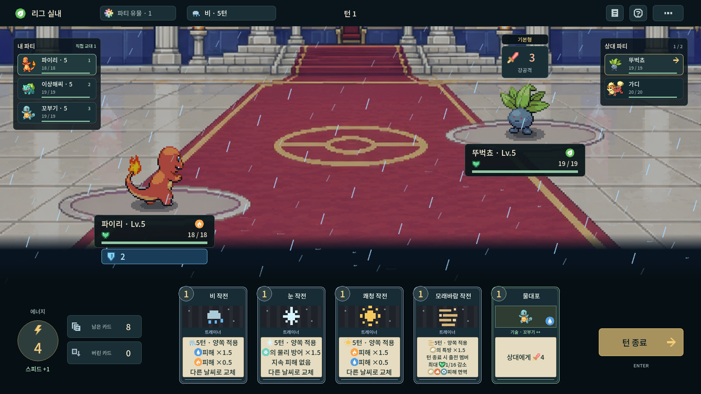
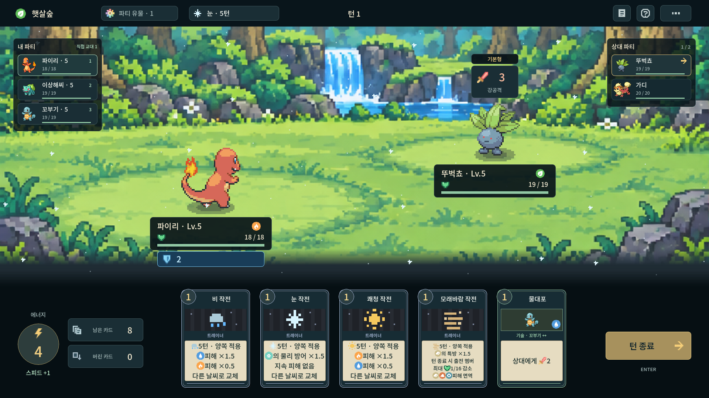
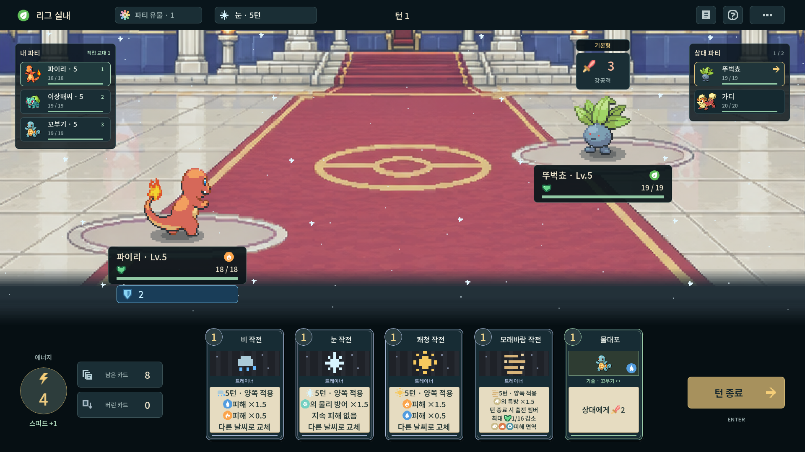
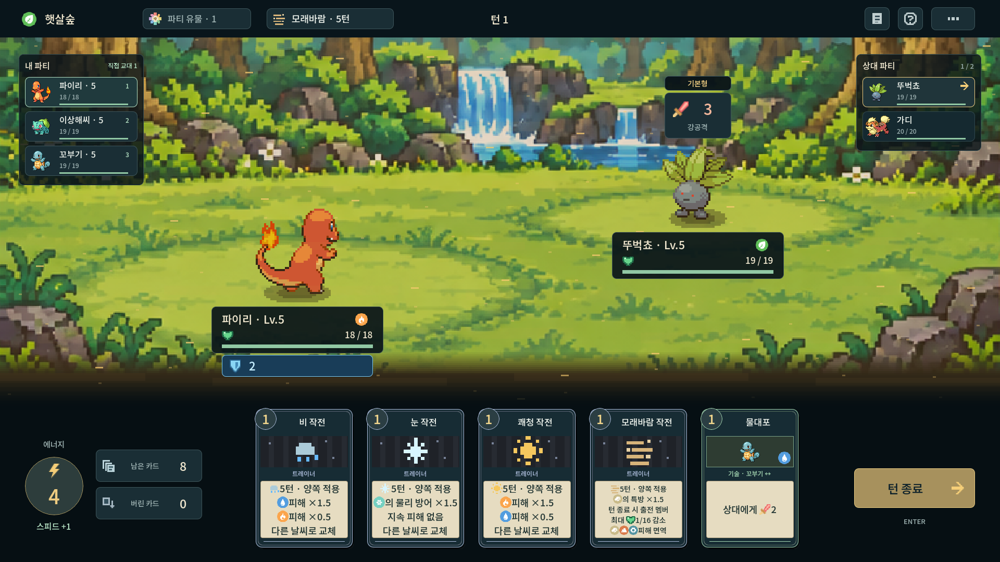
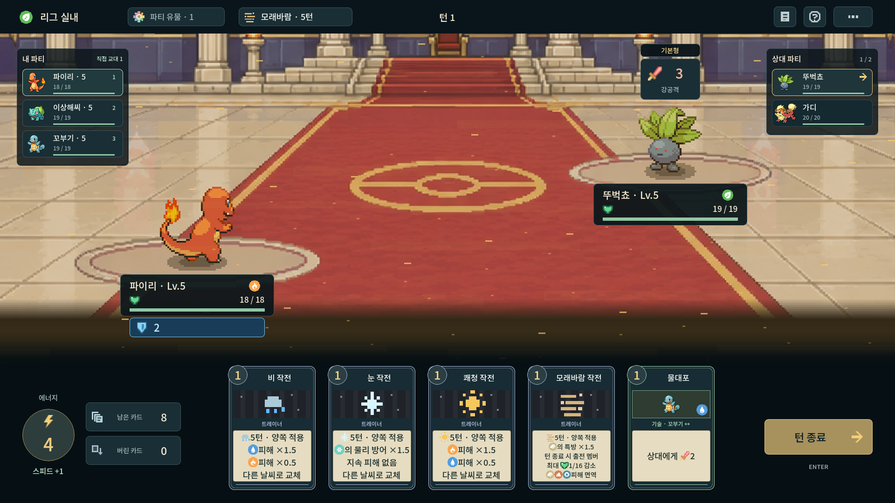

# 날씨가 보이는 배틀 필드

2026-10-17 · 코드 [`1b09da9`](https://github.com/agree-git/pokemon-deckbuilder/commit/1b09da9) · **실제 Godot 4.7.2/Linux의 1920×1080 화면 8장**.

전체 입자와 조명을 조금 더 선명하게 했고, 쾌청은 **왼쪽 위의 밝은 광원 → 퍼지는 햇살 → 대각선 렌즈 플레어**로 바꿨다. 날씨는 배경·포켓몬 전체에 적용하고 기술 효과와 UI는 그 위에 표시한다. 변경/종료 시 0.55초 동안 전환하며 하단에서 옅어진다.

[화면 8장 ZIP 다운로드](weather-field.zip) · [날씨 규칙·검증](https://github.com/agree-git/pokemon-deckbuilder/blob/main/docs/weather.md) · [앞서 추가한 날씨 카드](https://github.com/agree-git/pokemon-deckbuilder/blob/concept-review-2026-10-17/review/build-concepts/README.md#날씨)

비교를 위해 같은 파티·손패에서 야외/관동 리그 실내 배경과 날씨만 바꾼 개발 검토 장면이다. 정상 챔피언 파티나 난도를 나타내지 않는다. 각 이미지를 누르면 원본 크기로 볼 수 있다.

## 쾌청

왼쪽 위 후광·광원에서 펼쳐지는 빛줄기·대각선 렌즈 플레어.

**야외**

**리그 실내**

## 비

앞뒤 빗줄기·바닥 물결·푸른 흐린 조명.

**야외**

**리그 실내**

## 눈

크기와 속도가 다른 눈송이·차가운 공기.

**야외**

**리그 실내**

## 모래바람

황갈색 조명·수평 먼지층·빠르게 흐르는 모래 알갱이.

**야외**

**리그 실내**

실제 렌더러 검사 97개, 헤드리스 전장 검사 31개, X11 포인터 33개/12클릭, 기존 날씨 규칙/저장/획득 121개·전투 연출 28개를 확인했다. 상단 바·손패·파티 글자 보호, 세 창 비율, 날씨 전환/종료, 실제 움직임과 왼쪽 위 광원, 전투 상태/난수/배경 좌표 보존을 포함한다. Windows 실행 검증은 별도다.
